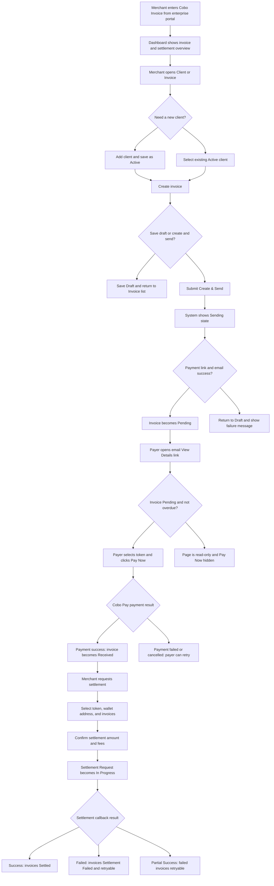

# PRD: Cobo Invoice 发票收款与结算平台

## Overview
**Version**: 1.0  
**Created Date**: 2026-09-04  
**Owner**: To be confirmed（Q-042）  

### One-sentence Product Description
Cobo Invoice 是面向 Cobo 企业客户的 PC Web 发票、加密货币收款与结算管理应用，并通过邮件链接为付款方提供发票查看与 Cobo Pay 支付入口。

### Background and Core Problem
Cobo 计划在新企业门户中提供 Web3 发票与收款能力，帮助企业用户在线管理客户、发票、付款状态、Dashboard 指标与结算流程。当前企业在加密货币收款场景中需要同时处理付款请求、状态跟踪、客户信息维护、钱包地址选择、结算申请与异常跟进，流程分散且效率较低，因此需要一个与 Cobo Pay、Cobo Wallet、邮件服务和结算能力集成的统一产品。

## Adjudication Overrides (Normalized)

下表只列**裁决结果与原文不一致**的地方 —— 也就是照原文实现会做错的那几处。
全部 60 条裁决（含理由、裁决人、日期）在 `.ab/questions.json`，本节不复述。

| 原文位置 | 原文怎么写 | 裁决 | 依据 |
|---|---|---|---|
| Entity: Invoice / Invoice Item 的金额小数位 | 6 位（unit_price 8 位） | **改为 2 位** | Q-057 修正 Q-020；Cobo payout 的 amount 最多两位非零小数，超出即报错 |
| **全文所有提到 Partial Success 的地方**（F010 与 F013 的 Notes、EH011、Settlement Request 状态机与状态枚举、Entity 的 status 字段、§Detail Page 的 Settlement Request Status 行、§File and External Integration Spec 的 Processing States、§Metrics 两处、US-007 相关 AC、异常表 Partial settlement 行、Sample Data） | 支持 Partial Success | **删除 Partial Success**；结算结果只有 In Progress / Success / Failed | Q-053；一次只结算一个 Token，payout_params 只有一项，Cobo 的 PartiallyCompleted 不会出现 |
| Metrics 的结算成功率 | (Success + Partial Success) / 总数 | **改为 Success / 总数** | Q-053 |
| Entity: Settlement Request 的 settlement_id | Cobo Settlement ID | **即 payout_id** | Q-053 |
| Entity: Settlement Request 的 wallet_id / wallet_address | 由 Cobo Wallet API 返回 | **改读 destination 注册表**（list-all-destinations / list-destination-entries，只读） | Q-059 |
| F014 的集成清单 | 含 Wallet API | **Wallet API 移出，destination 只读接口移入** | Q-059 |
| Payer Invoice Detail 的 Select payment method、Key Action Feedback 同名行 | 付款方在本页选币种 | **删除该模块**，币种在 Cobo 托管页选 | Q-056 |
| Invoice State Enum 的 Settled | Is Terminal = 是 | **改为否** | Q-003 |
| Invoice State Enum 的 Error | Is Terminal = 否 | **改为是** | Q-004 |
| Invoice State Enum 的 Overdue | 未定是否可 Void | **可 Void**，新增 Overdue → Voiding | Q-005 |
| Client State Transitions 的冻结前置条件 | 5 个状态 | **7 个**，补 Sending 与 Voiding | Q-007 |
| Client State Enum 的 Detail Page Display 列 | 存在该列 | **删除**，无 Client 详情页 | Q-012 |
| Recurring Series State Enum 的 List Display Copy 列 | 存在该列 | **删除**，Series 无列表页 | Q-013 |
| Recurring Series 的 end_type | `End Date / No End Date Manual Stop` | **两个值**：End Date / No End Date | Q-011 |
| Entity: Invoice 的 invoice_id 样例 | 客户号前缀 `CL001-…` | **商户号前缀**，格式定义为准 | Q-010 |
| F012、Entity: Settlement Request 的 invoice_service_fee、Assumptions 末条 | 2% 服务费 | **MVP 不收，恒为 0** | Q-026 |
| Metrics 的 Invoice Sent「按当前汇率折算法币」 | 有汇率折算 | **无汇率**，稳定币 1:1；异常表的 exchange rate 降级行与 Risks 的汇率行作废 | Q-016 |
| Delete 节与 Invoice Lifecycle 的「Draft 删除可否恢复」 | To be confirmed | **不可恢复**，以 Out of Scope 为准 | Q-024 |
| 全文缺失 | 无 Merchant 概念 | **不需要自建**：merchant_id 由 Cobo 带外注册（merchant_id=5、app_id=invoice） | Q-058 |
| 全文缺失 | 无「多付如何检测」 | 多付在 Cobo 侧落 Completed，**须比对 received_token_amount 与 payable_amount** | Q-054 |
| US-002 的 AC-011 | 边界值 `0.999999` | **改为 `0.99`**（2 位小数下刚好小于 1 的那个值） | Q-072 落实 Q-057 |
| US-005 的 AC-020 | 付款方页显示 token selection | **删去该要求**，币种在 Cobo 托管页选 | Q-072 落实 Q-056 |
| US-003 的 AC-015 | 「failure feedback To be confirmed」 | **填入** `Failed to delete the draft invoice` | Q-072 落实 Q-024 |
| US-008 的 AC-038 | 「failure handling is To be confirmed」 | **填入**「重试 3 次后跳过本期并邮件通知商户」 | Q-072 落实 Q-022 |
| US-007 的 AC-033 | 支持 Partial Success | **改为整笔成功或整笔失败** | 上一轮落实 Q-053 |

## Goals and Success Metrics

### Product Goal
建立一个面向企业用户的发票、收款和结算系统，支持商户在 Cobo 企业门户中：
- 管理付款方客户信息；
- 创建、保存、发送、复制、作废普通或周期发票；
- 通过 Cobo Pay 收取 `Tron-USDT / Tron-USDC / ETH-USDT / ETH-USDC`；
- 跟踪发票从草稿到付款、结算、失败、异常的完整状态；
- 查看发票发送、未收、已收等 Dashboard 指标；
- 对已收款或结算失败的发票发起手动结算，并将资金结算至选定钱包地址。

### Target Users
| User | Description | First-release Priority |
|---|---|---|
| Merchant | Cobo 企业门户登录用户，代表企业商户创建发票、收款、管理客户与结算 | P0 |
| Payer | 商户客户，通过邮件中的 View Details 链接访问单张发票并付款 | P0 |
| Super Admin | 异常提示中的人工支持对象，不提供本次产品界面 | 非界面角色 |

### User Pain
| User | Scenario | Pain |
|---|---|---|
| Merchant | 需要向企业或个人客户发起加密货币付款请求 | 手动生成付款信息、发送邮件、跟踪状态成本高 |
| Merchant | 需要管理多个付款方客户 | 客户信息重复录入、冻结客户与发票进行中状态缺乏约束 |
| Merchant | 需要知道发票是否已付款、是否逾期、是否异常 | 状态分散，无法在列表和 Dashboard 中快速判断 |
| Merchant | 需要把 Cobo Pay 中已收资金结算到钱包地址 | 需要选择币种、钱包、地址和可结算发票，并跟踪结算结果 |
| Payer | 收到发票邮件后需要查看明细并选择币种付款 | 需要清楚知道是否可支付、应付金额、支持币种和支付入口 |

### Metrics
| Metric | Category | Definition | Source / Notes |
|---|---|---|---|
| Invoice Sent Amount | User-visible | 指定时间范围内已发送发票按日汇总金额，按当前汇率折算法币展示 | Dashboard |
| Unreceived Amount | User-visible | 已发送但未付款发票金额，拆分 Overdue 与 Not Due | Dashboard |
| Received Invoice by Token | User-visible | 指定月份内已收到付款的发票按 Token 汇总金额 | Dashboard |
| Last Received | User-visible | 最近一次收到的发票付款金额、付款方与日期 | Dashboard |
| 发票创建成功率 | Internal | Create & Send 成功进入 Pending 的比例 | To be confirmed（Q-040） |
| 结算成功率 | Internal | Settlement Request 最终为 Success 或 Partial Success 的比例 | To be confirmed（Q-040） |

### Metrics and Demo Boundaries

#### Internal Success Metrics
Used for product evaluation; not shown in the user interface by default.

| Metric | Definition | UI Visibility |
|---|---|---|
| 发票创建成功率 | Create & Send 成功生成支付链接并发送邮件后进入 Pending 的比例 | 默认不展示 |
| 结算成功率 | Settlement Request 最终为 Success 或 Partial Success 的比例 | 默认不展示 |
| 支付链路失败率 | Cobo Pay 支付失败、取消或超时比例 | 默认不展示 |
| 邮件发送失败率 | 发票邮件或通知邮件发送失败比例 | 默认不展示 |

#### User-visible Metrics
If displayed, you must define:
- Which page it is shown on
- Definition/formula
- Time range
- Whether it can be drilled into by clicking
- Which roles can see it

| Metric | Page | Definition / Formula | Time Range | Drill-down | Roles |
|---|---|---|---|---|---|
| Invoice Sent | Dashboard | 每日已发送发票总金额，按当前汇率折算法币，并按 Pending、Received、Settled、Error、Other 堆叠 | 自定义开始/结束日期，最多 15 天 | To be confirmed（Q-038） | Merchant |
| Unreceived | Dashboard | Sent 但未付款发票金额；Unpaid = Not Due + Overdue | 默认 Last 30 days，可选 Last 30 / 90 / 120 days / All | To be confirmed（Q-038） | Merchant |
| Received Invoice | Dashboard | 所选月份已收款发票按 Token 汇总金额 | 年月选择 | To be confirmed（Q-038） | Merchant |
| Last Received | Dashboard | 最近一次 Received 发票的付款金额、付款方、日期 | 当前可用最近记录 | To be confirmed（Q-038） | Merchant |
| Last Settled Amount | Settlement | 上一次结算成功的 Crypto 金额 | 最近一次 Success Settlement Request | 可点击进入结算详情 | Merchant |
| Total Settlement Pending | Settlement | 当前结算中 Crypto 金额，按 Token 展示 | 当前 In Progress / Partial processing 相关金额 | To be confirmed（Q-038） | Merchant |

#### Prototype/Demo Helper Capabilities
Things like simulate completion, skip processing, mock payment, or simulate network recovery must be labeled "demo helper" only, and must not be written into formal product features.

| Capability | Demo-only Rule |
|---|---|
| 模拟付款成功 | 仅作为原型演示辅助，不进入正式 Feature List |
| 模拟结算回调成功/失败/部分成功 | 仅作为原型演示辅助，不进入正式 Feature List |
| 模拟 API 超时恢复 | 仅作为原型演示辅助，不进入正式 Feature List |
| 预置多状态发票数据 | 放入 Sample Data / Prototype Notes，不作为产品功能 |

#### Multi-role Demo Mechanism
| Item | Prototype Default |
|---|---|
| Simulate real login? | 否；Assumption / to be confirmed（Q-043）：原型中不模拟真实 Cobo 企业门户登录 |
| Role-switch mechanism (e.g. a switcher control, preset demo accounts) | Assumption / to be confirmed（Q-043）：使用原型顶部角色切换器在 Merchant / Payer 间切换 |
| Switchable roles | Merchant、Payer |
| Enters the formal feature list? | 否；仅为 demo helper |
| Default landing page after switching role | Merchant：Dashboard；Payer：邮件链接进入的发票详情页 |
| Does data state persist across switches? | Assumption / to be confirmed（Q-043）：原型内持久化当前演示数据状态 |
| How no-permission pages/states are demoed | 直接访问无权限页面时展示 No permission 页面；Payer 不展示 Merchant 导航 |

## Feature List

### P0
| Feature ID | Feature Name | Description | User Value | Notes |
|---|---|---|---|---|
| F001 | Client 管理 | 商户可搜索、过滤、新增、编辑、冻结、重新激活客户 | 减少重复录入，创建发票时快速选择付款方 | 冻结客户前需校验是否存在进行中发票 |
| F002 | Invoice 列表与状态跟踪 | 商户查看发票列表、状态数量、搜索、过滤、排序、空状态 | 快速定位发票并判断付款、逾期、结算和异常状态 | 状态机以本 PRD 为准 |
| F003 | 创建与发送发票 | 商户可创建普通发票，保存草稿或生成支付链接并发送邮件 | 完成收款请求发起 | 支持多 Token；Create & Send 先进入 Sending，成功后进入 Pending |
| F004 | 编辑、删除草稿发票 | 商户可编辑 Draft 发票并保存或发送，Draft 可删除 | 支持发票发送前修正 | 非 Draft 不可编辑 |
| F005 | 复制发票 | 商户可基于已有发票复制生成新 Draft 发票 | 提高重复开票效率 | 新 Invoice ID，Issue Date 默认为当前日期，Due Date 默认 30 天后 |
| F006 | 作废 Pending 发票 | 商户可对 Pending 发票填写原因并作废 | 支持取消未付款发票 | Pending → Voiding → Voided；失败回到 Pending 可重试 |
| F007 | Recurring Invoice 周期发票 | 商户可设置周期发票频率和结束条件，系统基于 Recurring Series 自动生成并发送单张 Invoice | 支持固定周期收款 | Recurring Series 状态：Active / Discontinued / Completed |
| F008 | 付款方邮件与发票付款页 | Payer 通过邮件链接查看发票详情，Pending 且未过期时可选择 Token 并 Pay Now | 降低付款方支付门槛 | 其他状态只读并隐藏 Pay Now |
| F009 | Dashboard 指标 | 商户查看发票发送、未收、已收、最近收款等指标 | 提供应收与回款概览 | 无汇率折算（Q-016，稳定币 1:1 按 USD）；不支持指标钻取（Q-038）；日期范围见 §User-visible Metrics |
| F010 | Settlement 结算列表 | 商户查看结算请求、上次结算金额、待结算中金额，并搜索/过滤 | 跟踪结算结果 | 状态：In Progress / Success / Failed / Partial Success |
| F011 | 发起结算申请 | 商户选择币种、钱包、地址、可结算发票并提交结算 | 将已收资金结算到钱包地址 | 支持 Received 与 Settlement Failed 发票 |
| F012 | 结算确认与费用展示 | 商户确认结算发票数量、金额、预估费用后提交 | 降低误操作和费用不透明 | Invoice 服务费暂按 2% To be confirmed（Q-026） |
| F013 | 结算详情 | 商户查看 Settlement Request 基本信息及关联发票状态 | 支持结算结果追踪和失败重试判断 | 部分成功时需显示成功和失败发票 |
| F014 | Cobo 外部集成 | 集成 Cobo Pay、支付链接、邮件服务、Wallet API、Settlement API 和回调 | 完成支付与结算闭环 | 参数、认证、错误码需后续技术规格补齐 |

### P1
To be confirmed（Q-041）

### P2
To be confirmed（Q-041）

## Page Map and Information Architecture (Required)

### Navigation Skeleton and Default Landing Page
| Role | Top-level Navigation Items (in order) | Default Landing Page | Rationale |
|---|---|---|---|
| Merchant | Dashboard / Client / Invoice / Settlement | Dashboard | Dashboard 提供整体应收、未收、已收与结算概览，适合作为商户进入后的默认入口 |
| Payer | 无正式导航；邮件链接直达发票详情页 | Payer Invoice Detail | Payer 的核心任务是查看单张发票并在可支付状态下付款 |
| Super Admin | 不提供产品内页面 | 不适用 | 仅作为异常提示中的人工支持对象 |

### Merchant Page Map
| Page Name | Platform | Roles | Page Level | Parent Page | Entry Method | Page Goal | Main Modules | Main Actions | Reachable Pages | Empty/Default State |
|---|---|---|---|---|---|---|---|---|---|---|
| Dashboard | PC Web / Cobo 企业门户 | Merchant | 一级 | 无 | 登录/进入应用默认页；顶部/侧边导航点击 Dashboard | 查看发票收款概览 | Invoice Sent、Unreceived、Received Invoice、Last Received | 选择日期范围、选择月份、切换未收范围 | To be confirmed（Q-038） | 无数据时图表展示空状态与引导创建发票 |
| Client List | PC Web / Cobo 企业门户 | Merchant | 一级 | 无 | 导航点击 Client | 管理付款方客户信息 | 搜索、过滤、客户表格 | Add Client、Edit、Freeze、Unfreeze | Add/Edit Client Modal、Freeze/Unfreeze Confirm Modal | 无客户时提示添加客户 |
| Add/Edit Client Modal | PC Web / Cobo 企业门户 | Merchant | 二级弹窗 | Client List / Create Invoice | Add Client 或 Edit | 新增或修改客户资料 | Client Email、Client Type、Client Name | Add Client、Save、Cancel | 返回来源页 | 默认空表单或填充已有值 |
| Invoice List | PC Web / Cobo 企业门户 | Merchant | 一级 | 无 | 导航点击 Invoice | 查看和管理发票 | 状态计数、搜索、过滤、发票表格 | Create New Invoice、View Detail、Edit、Send Reminder、Duplicate、Void | Create/Edit/Duplicate Invoice Page、Invoice Detail、Void Modal | `There are no invoice records yet.` |
| Create Invoice Page | PC Web / Cobo 企业门户 | Merchant | 二级 | Invoice List | Create New Invoice | 创建并保存/发送发票 | 基本信息、Client、CC、Token、Item、统计、Category、Memo、Recurring | Save Draft、Create&Send、Add Item、Add Client、Add CC | Invoice List、Client Modal、CC Modal | 新发票默认 Draft，Issue Date 当前日期，Due Date 30 天后 |
| Invoice Detail Page | PC Web / Cobo 企业门户 | Merchant | 二级 | Invoice List | View Detail | 查看单张发票完整信息 | 状态、基本信息、周期信息、Token、Item、统计、备注 | Send Reminder、Duplicate、Discontinue recurring | Invoice List、Duplicate Invoice Page、Recurring Confirm Modal | To be confirmed（Q-044） |
| Edit Draft Invoice Page | PC Web / Cobo 企业门户 | Merchant | 二级 | Invoice List | Draft 发票 Edit | 修改 Draft 发票 | 同创建页，带 Draft 状态 | Save Draft、Create&Send、Delete、Duplicate、Send Reminder | Invoice List、Duplicate Invoice Page | 填充当前 Draft 数据 |
| Duplicate Invoice Page | PC Web / Cobo 企业门户 | Merchant | 二级 | Invoice List / Invoice Detail | Duplicate Invoice | 基于已有发票生成新 Draft | 同创建页，复制原发票内容 | Save Draft、Create&Send | Invoice List | 新 Invoice ID，Draft 状态 |
| Void Invoice Modal | PC Web / Cobo 企业门户 | Merchant | 二级弹窗 | Invoice List | Pending 发票 Void | 填写原因并作废发票 | Void reason | Void invoice、Cancel | 返回 Invoice List | 原因输入为空 |
| Settlement List | PC Web / Cobo 企业门户 | Merchant | 一级 | 无 | 导航点击 Settlement | 查看结算请求并进入结算申请 | Last Settled Amount、Total Settlement Pending、搜索、过滤、结算表格 | Request Settlement、View Detail | Settlement Request Page、Settlement Detail | 无结算时展示空状态并引导 Request Settlement |
| Settlement Request Page | PC Web / Cobo 企业门户 | Merchant | 二级 | Settlement List | Request Settlement | 选择币种、钱包地址与可结算发票 | Token、Wallet、Wallet Address、搜索、过滤、发票选择表格 | Settlement | Settlement Confirmation Page | 无可结算发票时提示暂无 Received 或 Settlement Failed 发票 |
| Settlement Confirmation Page | PC Web / Cobo 企业门户 | Merchant | 三级 | Settlement Request Page | 点击 Settlement | 确认结算金额、费用与提交 | 发票数量、总金额、预估费用、费用说明 | Confirm | Settlement List / Settlement Detail | Confirm 默认可用条件为已选钱包地址与发票 |
| Settlement Detail Page | PC Web / Cobo 企业门户 | Merchant | 二级 | Settlement List | View Detail 或 Last Settled Amount | 查看结算请求及关联发票结果 | 结算基本信息、发票列表、搜索、过滤 | 返回列表 | Settlement List | To be confirmed（Q-044） |

### Payer Page Map
| Page Name | Platform | Roles | Page Level | Parent Page | Entry Method | Page Goal | Main Modules | Main Actions | Reachable Pages | Empty/Default State |
|---|---|---|---|---|---|---|---|---|---|---|
| Invoice Email | Email | Payer | 入口消息 | 无 | Merchant Create&Send 后系统发送 | 通知付款方查看发票 | 商户名、Logo、Due Date、To、From、Token、金额、Powered by Cobo Pay | View Details | Payer Invoice Detail | To be confirmed（Q-044） |
| Payer Invoice Detail | H5 / Web Link | Payer | 一级直达 | Invoice Email | 点击 View Details 链接 | 查看发票并在可支付时付款 | 状态、日期、From、Billed To、Token、Item、统计、Category、Memo | Select payment method、Pay Now | Cobo Pay Payment Page | 非 Pending 未过期时隐藏 Pay Now 并显示状态说明 |
| Cobo Pay Payment Page | Cobo Pay 页面 / To be confirmed（Q-019） | Payer | 二级外部支付页 | Payer Invoice Detail | Pay Now | 完成付款 | 支付金额、Token、支付地址/组件 | Pay、Cancel / To be confirmed | Payer Invoice Detail / Payment Result | To be confirmed |

## Page ID and Route Index (Normalized)

本节由归一化补出，供 `page-coverage` 与任务拆解使用；页面集合与上文 Page Map 一致，未新增或删减页面。

- 挂载前缀 `/apps/invoice/*` 与凭据形态（token）由 Q-014 裁定。
- 路由名沿用 `docs/prototype.html` 的 `data-bp-view` 视图名，未另行发明。
- **弹窗不占路由**：Add/Edit Client Modal、Void Invoice Modal、CC Modal 作为所属页面的交互组件登记在 `.ab/prd.json` 的 `interactiveComponents` 中。
- **不在本清单内的两项**：Invoice Email 是邮件不是页面；Cobo Pay Payment Page 由 Q-019 裁定为 Cobo 托管的外部页面。

| Page ID | Page Name | Route | Roles |
|---|---|---|---|
| PAGE-001 | Dashboard | `/apps/invoice/dashboard` | Merchant |
| PAGE-002 | Client List | `/apps/invoice/clients` | Merchant |
| PAGE-003 | Invoice List | `/apps/invoice/invoices` | Merchant |
| PAGE-004 | Create Invoice Page | `/apps/invoice/invoices/new` | Merchant |
| PAGE-005 | Edit Draft Invoice Page | `/apps/invoice/invoices/:invoiceId/edit` | Merchant |
| PAGE-006 | Duplicate Invoice Page | `/apps/invoice/invoices/:invoiceId/duplicate` | Merchant |
| PAGE-007 | Invoice Detail Page | `/apps/invoice/invoices/:invoiceId` | Merchant |
| PAGE-008 | Settlement List | `/apps/invoice/settlements` | Merchant |
| PAGE-009 | Settlement Request Page | `/apps/invoice/settlements/new` | Merchant |
| PAGE-010 | Settlement Confirmation Page | `/apps/invoice/settlements/new/confirm` | Merchant |
| PAGE-011 | Settlement Detail Page | `/apps/invoice/settlements/:requestId` | Merchant |
| PAGE-012 | No Permission | `/apps/invoice/no-permission` | Payer / Merchant |
| PAGE-013 | Payer Invoice Detail | `/apps/invoice/pay/:token` | Payer |

## Page Responsibilities and Module Boundaries (Required)

| Page | Core User Task | Must Show | Optional to Show | Must Not Show | Key CTA | Page Completion Criteria |
|---|---|---|---|---|---|---|
| Dashboard | 查看发票收款概览 | Invoice Sent、Unreceived、Received Invoice、Last Received | 指标钻取入口 To be confirmed（Q-038） | 不放置客户编辑、发票编辑、结算确认表单 | 日期/月份筛选 | 商户能判断近期发送、未收、已收情况 |
| Client List | 管理客户 | 客户表格、搜索、过滤、状态、操作 | 分页 To be confirmed（Q-028） | 不展示发票详情和结算配置 | Add Client | 商户能找到、添加、编辑、冻结或激活客户 |
| Add/Edit Client Modal | 录入客户信息 | Email、Type、Name、校验提示 | To be confirmed（Q-045） | 不展示客户历史发票详情 | Add Client / Save | 成功保存或取消返回来源页 |
| Invoice List | 跟踪和管理发票 | 状态计数、搜索、过滤、发票表格、状态、操作 | 分页 To be confirmed（Q-028） | 不混入结算确认和客户编辑表单 | Create New Invoice | 商户能定位发票并进入相应操作 |
| Create Invoice Page | 创建发票 | Invoice ID、From、Issue/Due Date、Client、Token、Item、统计、Category、Memo、Recurring | CC Recipient | 不展示历史结算明细 | Save Draft / Create&Send | 发票保存为 Draft 或发送进入 Sending/Pending |
| Invoice Detail Page | 查看对象详情 | 发票状态、基本信息、商品、统计、周期信息 | Send Reminder、Duplicate | 不允许直接编辑非 Draft 字段 | Duplicate / Send Reminder | 商户确认发票内容与状态 |
| Edit Draft Invoice Page | 编辑 Draft 对象 | Draft 发票字段和校验 | Duplicate、Send Reminder | 不展示结算日志作为主模块 | Save Draft / Create&Send | Draft 更新或发送 |
| Void Invoice Modal | 作废 Pending 发票 | 作废原因、确认提示 | To be confirmed（Q-045） | 不编辑发票金额或客户 | Void invoice | 发票进入 Voiding 或失败回 Pending |
| Settlement List | 管理结算请求 | Last Settled Amount、Total Settlement Pending、结算表格 | 筛选、搜索 | 不放置发票创建表单 | Request Settlement | 商户能进入结算申请或查看结果 |
| Settlement Request Page | 选择待结算对象 | Token、Wallet、Wallet Address、可结算发票列表 | 高级过滤 To be confirmed（Q-045） | 不提交前展示不可更改最终结果 | Settlement | 选中发票并进入确认页 |
| Settlement Confirmation Page | 确认并提交结算 | 发票数量、金额、预估费用、费用说明 | 明细展开 To be confirmed（Q-045） | 不编辑发票字段 | Confirm | 创建 Settlement Request 并进入 In Progress |
| Settlement Detail Page | 查看结算记录详情 | Request ID、创建时间、金额、地址、状态、关联发票 | 搜索、过滤 | 不修改结算配置 | 返回列表 | 商户能判断成功、失败或部分成功 |
| Payer Invoice Detail | 查看并付款 | 发票状态、金额、Token、明细、Pay Now 条件 | 商户 Logo | 不展示商户后台导航和结算信息 | Pay Now | Payer 完成付款或看到不可支付原因 |

## Basic Manageable-Object Page Rules (Required when applicable)

### List Page
- Displayed fields
  - Client：Create Time、Client Name、Client Type、Email Address、Status、Action。
  - Invoice：Creation Time、Invoice ID、Client Name、Invoice Type、Amount、Status、Action。
  - Settlement：Create Time、Settlement Request ID、Amount、Status、Action。
- Default sort order
  - Client：Create Time 倒序。
  - Invoice：Creation Time 倒序。
  - Settlement：Create Time 倒序 / To be confirmed（Q-028）。
- Whether search/filter is supported
  - Client：按 Email 或 Name 搜索；按 Type、Status 过滤。
  - Invoice：按 Client Name 或 Category 搜索；按 Invoice Type、Token、Creation Time、Status 过滤。
  - Settlement：按 Settlement Request ID 搜索；按 Token、Status、Create Time 过滤。
- Empty state
  - Invoice：`There are no invoice records yet.`
  - Client：Assumption / to be confirmed（Q-031）：`There are no client records yet. Add a client to create invoices faster.`
  - Settlement：Assumption / to be confirmed（Q-031）：`There are no settlement records yet.`
- Row click behavior
  - Client：To be confirmed（Q-030），默认不整行跳转，仅 Action 操作。
  - Invoice：Assumption / to be confirmed（Q-030）：点击 View Detail 进入详情，整行点击不跳转。
  - Settlement：点击 View Detail 进入详情。

### Detail Page
- Fields
  - Invoice Detail：Invoice ID、Status、From、Issue Date、Due Date、Client、CC Recipient、Payment Token、Items、Overall Discount、Amount without tax、Total Tax amount、Discount、Total amount、Due、Category、Memo、Recurring 信息。
  - Settlement Detail：Settlement Request ID、Creation Time、Amount、Wallet Address、Status、关联发票。
- Status
  - Invoice Status：见 Core Object State Machines。
  - Settlement Request Status：In Progress / Success / Failed / Partial Success。
- Action buttons
  - Invoice：Send Reminder、Duplicate；Recurring Active 时可 Discontinue。
  - Settlement：返回列表；To be confirmed（Q-038） 是否支持导出。
- Return path
  - 从 Invoice List 进入的详情返回 Invoice List，并保留筛选条件。
  - 从 Settlement List 进入的详情返回 Settlement List，并保留筛选条件。

### Edit Page
- Fields
  - Client：Client Type、Client Name；Client Email 只读。
  - Draft Invoice：创建发票的可编辑字段。
- Validation
  - 必填、格式、重复、长度、金额下限、日期范围、Token、Frozen Client 等。
- Save feedback
  - Client：`Successfully edited the client.` / `Failed to edit the client`
  - Draft Invoice：`Successfully edited the draft invoice` / `Failed to edit the draft invoice`
- Cancel behavior
  - 弹窗 Cancel 关闭并不保存。
  - 页面级取消/返回是否提示未保存变更：To be confirmed（Q-029）。

### Delete
- Delete entry point
  - Draft Invoice 编辑页 Action 中 Delete。
- Confirmation copy
  - `Are you sure you want to delete this draft invoice?`
- Post-delete state
  - 删除成功后返回 Invoice List，并从列表移除。
- Whether recoverable
  - To be confirmed（Q-024）；Assumption / to be confirmed：不可恢复。
- Whether related data is affected
  - 不影响 Client；不生成付款链接；不影响 Settlement。

### History/Versions
- Whether retained
  - Invoice 状态变化历史：To be confirmed（Q-023）。
  - Draft 删除历史：To be confirmed（Q-023）。
  - Recurring Series 生成记录：应保留，以支持周期发票详情和审计；具体展示 To be confirmed（Q-023）。
- Displayed fields
  - To be confirmed（Q-023）。
- Whether recoverable/comparable
  - To be confirmed（Q-023）。

## Multi-platform and Back-office Split (Required when applicable)

| Platform/Workbench | Roles | Access Entry | Top-level Pages | Core Tasks | Relationship to Other Platforms |
|---|---|---|---|---|---|
| Cobo 企业门户 PC Web 商户端 | Merchant | Cobo 企业门户登录后进入 Cobo Invoice | Dashboard / Client / Invoice / Settlement | 管理客户、创建发票、跟踪状态、发起结算、查看 Dashboard | 发送邮件链接给 Payer；调用 Cobo Pay、Wallet、Settlement、Email 服务 |
| Payer 发票链接页 | Payer | 邮件 View Details 链接 | 无全局导航，直达 Payer Invoice Detail | 查看单张发票，Pending 且未过期时付款 | 调用 Cobo Pay 支付页；付款结果回写 Invoice 状态 |
| Cobo Pay 支付页 / 组件 | Payer | Payer Invoice Detail 点击 Pay Now | To be confirmed（Q-019） | 完成加密货币支付 | 支付结果通过 Cobo Pay 回调更新 Invoice |
| Operations / Super Admin Back-office | Super Admin | 不在本次界面范围内 | 不提供 | 人工处理 Sending / Voiding 超 24 小时或 Error 异常 | 仅在提示文案中出现 |

## Data Model and Field Schema (Required)

### Entity: Client
| Field Name | Type | Required | Enum/Format | Default | Validation Rule | User-visible | Editable | Notes |
|---|---|---|---|---|---|---|---|---|
| client_id | String | Yes | 系统生成 | 自动生成 | 唯一 | 否 | 否 | To be confirmed（Q-047） |
| create_time | Datetime | Yes | ISO datetime | 当前时间 | 系统生成 | 是 | 否 | 列表展示 |
| client_email | String | Yes | Email | 无 | 必填、邮箱格式、不可重复 | 是 | 新增时可填；编辑只读 | 创建发票选择时展示 |
| client_type | Enum | Yes | Enterprise / Personal | 无 | 必选 | 是 | 是 | 过滤条件 |
| client_name | String | Yes | 3–100 字符 | 无 | 允许字母、数字、空格及常见特殊字符 | 是 | 是 | 企业填企业名，个人填姓名 |
| status | Enum | Yes | Active / Frozen | Active | 冻结前校验进行中发票 | 是 | 通过操作变更 | 冻结后不可发起相关发票操作 |
| update_time | Datetime | No | ISO datetime | 无 | 编辑时系统更新 | To be confirmed（Q-039） | 否 | To be confirmed |

#### Client Status Enum
- Active
- Frozen

#### Client Sample Data
| client_id | create_time | client_email | client_type | client_name | status |
|---|---|---|---|---|---|
| CL-001 | 2026-09-01 10:00:00 | ap@alpha.com | Enterprise | Alpha Labs | Active |
| CL-002 | 2026-09-02 11:30:00 | ben@example.com | Personal | Ben Miller | Active |
| CL-003 | 2026-09-03 09:20:00 | finance@frozen.io | Enterprise | Frozen Finance | Frozen |

#### Client Validation Error Copy
| Field / Scenario | Copy |
|---|---|
| Client Email empty | `Please enter the client email.` |
| Client Type empty | `Please enter the client type.` / 编辑页：`Please choose the client type.` |
| Client Name empty | `Please enter the client name.` |
| Invalid email | `Please enter correct email address` / 编辑页：`Please enter the correct email address` |
| Duplicate email | `A client with the email xxx@google.gmail already exists.` |
| Edit duplicate email | `The entered client email address is a duplicate of an existing one.` |

### Entity: Invoice
| Field Name | Type | Required | Enum/Format | Default | Validation Rule | User-visible | Editable | Notes |
|---|---|---|---|---|---|---|---|---|
| invoice_id | String | Yes | `CUST123-YYYYMMDD-hash` | 系统生成 | 唯一 | 是 | 否 | 复制时生成新 ID |
| invoice_type | Enum | Yes | Regular / Recurring | Regular | To be confirmed（Q-047） | 是 | 部分可编辑 | Recurring 关联 series_id |
| status | Enum | Yes | Draft / Sending / Pending / Received / Voiding / Voided / Settling / Settled / Settlement Failed / Overdue / Error | Draft | 状态机约束 | 是 | 否 | 核心状态 |
| from_name | String | Yes | 商户名 | Cobo 企业账户 | 不可编辑 | 是 | 否 | 来源 Cobo 企业账户 |
| issue_date | Date | Yes | 日期 | 当前日期 | 不得晚于当前日期 | 是 | Draft 可编辑 | 错误文案见下 |
| due_date | Date | Yes | 日期 | 当前日期 + 30 天 | 不得早于当前日期 | 是 | Draft 可编辑 | 过期后状态 Overdue |
| client_id | String | Yes | Client ID | 无 | 必选；Create&Send 需 Active | 是 | Draft 可编辑 | 下拉只显示 Active |
| client_name | String | Yes | 复制自 Client | 无 | To be confirmed（Q-047） | 是 | 随 Client 选择 | 展示字段 |
| client_email | String | Yes | Email | 无 | To be confirmed（Q-047） | 是 | 随 Client 选择 | 邮件发送对象 |
| cc_recipients | Array | No | Email，最多 3 个 | 空 | 每个邮箱格式正确 | 是 | Draft 可编辑 | 弹窗维护 |
| payment_tokens | Array | Yes | Tron-USDT / Tron-USDC / ETH-USDT / ETH-USDC | 无 | 至少选择 1 个 | 是 | Draft 可编辑 | 支持单选或多选 |
| primary_token | Enum | Yes | 同 payment_tokens | 按优先级自动确定 | 优先级 Tron-USDT > Tron-USDC > ETH-USDT > ETH-USDC | 是 | 否 | 未付款列表金额显示主币 |
| category | String | No | <100 字符 | 空 | 创建页 <100；编辑页 3–100 存在冲突，按 <100 处理，To be confirmed（Q-002） | 是 | Draft 可编辑 | 只允许一个 Category |
| memo | String | No | <500 字符 | 空 | 创建页 <500；编辑页 3–500 存在冲突，按 <500 处理，To be confirmed（Q-002） | 是 | Draft 可编辑 | 备注 |
| overall_discount | Decimal | No | 0–100% | 0 | 0 ≤ value < 100，To be confirmed（Q-001） 是否允许 100 | 是 | Draft 可编辑 | 折上折 |
| amount_without_tax | Decimal | Yes | 最多 To be confirmed（Q-020） 位小数 | 系统计算 | 不可手填 | 是 | 否 | 按 Token 计算 |
| total_tax_amount | Decimal | Yes | 最多 To be confirmed（Q-020） 位小数 | 系统计算 | 不可手填 | 是 | 否 | To be confirmed |
| discount_amount | Decimal | Yes | 最多 To be confirmed（Q-020） 位小数 | 系统计算 | 不可手填 | 是 | 否 | 展示负数 To be confirmed |
| total_amount | Decimal | Yes | 最多 To be confirmed（Q-009、Q-020） 位小数 | 系统计算 | Due | Due >= 1 | 是 | 否 | Due 保留 6 位小数 |
| create_time | Datetime | Yes | ISO datetime | 保存时当前时间 | 系统生成 | 是 | 否 | 列表排序 |
| update_time | Datetime | No | ISO datetime | 编辑时当前时间 | 系统生成 | To be confirmed（Q-039） | 否 | Draft 编辑 |
| send_time | Datetime | No | ISO datetime | Create&Send 当前时间 | 系统生成 | To be confirmed（Q-039） | 否 | 发票发送时间 |
| payment_link | URL | No | URL | 支付链接生成后写入 | Cobo API 返回 | Payer 可见入口 | 否 | 生成失败回 Draft |
| void_reason | String | Conditional | 3–500 字符 | 空 | Void 必填 | Merchant 可见 | Pending Void 时填写 | Voided 状态展示原因 |
| series_id | String | Conditional | Recurring Series ID | Recurring 时生成 | To be confirmed（Q-039） | To be confirmed | 否 | 周期发票关联 |

### Entity: Invoice Item
| Field Name | Type | Required | Enum/Format | Default | Validation Rule | User-visible | Editable | Notes |
|---|---|---|---|---|---|---|---|---|
| item_id | String | Yes | 系统生成 | 自动生成 | 唯一 | 否 | 否 | To be confirmed（Q-047） |
| invoice_id | String | Yes | Invoice ID | 无 | 必须关联 Invoice | 否 | 否 | To be confirmed（Q-047） |
| item_name | String | Yes | 3–100 字符 | 空 | 必填 | 是 | Draft 可编辑 | 商品名称或内容 |
| qty | Integer | Yes | >0 整数 | 空 | 必填；大于 0 整数 | 是 | Draft 可编辑 | 至少一行 item |
| unit_price_by_token | Object | Yes | Token → Decimal | 空 | 每个选中 Token 需填；>0；最多 8 位小数 | 是 | Draft 可编辑 | 多 Token 时显示多个价格输入 |
| discount | Decimal | No | 0–100% | 0 | 0 ≤ value < 100；源文档有“大于0”冲突，按允许 0 处理，To be confirmed（Q-001） | 是 | Draft 可编辑 | 单行折扣 |
| tax | Decimal | No | 0–100% | 0 | 0 ≤ value < 100；源文档有“大于0”冲突，按允许 0 处理，To be confirmed（Q-001） | 是 | Draft 可编辑 | 单行税率 |
| amount_by_token | Object | Yes | Token → Decimal | 系统计算 | 不可手填 | 是 | 否 | `unit price * qty * (1-discount) * (1-overall discount) * (1+tax)` |

#### Invoice Status Enum
- Draft
- Sending
- Pending
- Received
- Voiding
- Voided
- Settling
- Settled
- Settlement Failed
- Overdue
- Error

#### Invoice Sample Data
| invoice_id | invoice_type | status | client_name | payment_tokens | primary_token | total_amount | due_date | notes |
|---|---|---|---|---|---|---|---|---|
| CL001-20260901-a1b2 | Regular | Draft | Alpha Labs | Tron-USDT | Tron-USDT | 100.00 | 2026-10-01 | 可编辑、可删除 |
| CL001-20260902-b2c3 | Regular | Sending | Alpha Labs | Tron-USDT / ETH-USDC | Tron-USDT | 250.00 | 2026-10-02 | 正在生成支付链接/发送邮件 |
| CL002-20260903-c3d4 | Regular | Pending | Ben Miller | Tron-USDC | Tron-USDC | 80.00 | 2026-10-03 | Payer 可付款 |
| CL002-20260801-d4e5 | Regular | Overdue | Ben Miller | ETH-USDT | ETH-USDT | 120.00 | 2026-08-31 | 只读不可付款 |
| CL001-20260904-e5f6 | Regular | Received | Alpha Labs | Tron-USDT | Tron-USDT | 300.00 | 2026-10-04 | 可进入结算 |
| CL001-20260905-f6g7 | Regular | Settling | Alpha Labs | Tron-USDT | Tron-USDT | 300.00 | 2026-10-05 | 结算中 |
| CL001-20260906-g7h8 | Regular | Settled | Alpha Labs | Tron-USDT | Tron-USDT | 300.00 | 2026-10-06 | 已结算 |
| CL001-20260907-h8i9 | Regular | Settlement Failed | Alpha Labs | Tron-USDT | Tron-USDT | 200.00 | 2026-10-07 | 可重试结算 |
| CL002-20260908-i9j0 | Regular | Voiding | Ben Miller | ETH-USDC | ETH-USDC | 60.00 | 2026-10-08 | 作废中 |
| CL002-20260909-j0k1 | Regular | Voided | Ben Miller | ETH-USDC | ETH-USDC | 60.00 | 2026-10-09 | 已作废，显示原因 |
| CL003-20260910-k1l2 | Regular | Error | Frozen Finance | Tron-USDT | Tron-USDT | 99.00 | 2026-10-10 | 支付异常，联系 Super Admin |
| CL001-20260911-l2m3 | Recurring | Pending | Alpha Labs | Tron-USDT | Tron-USDT | 50.00 | 2026-10-11 | 周期生成单张发票 |
| CL001-20260912-m3n4 | Regular | Draft | Alpha Labs | Tron-USDT | Tron-USDT | 1.00 | 2026-10-12 | 金额边界：等于 1 |
| CL001-20260913-n4o5 | Regular | Draft | Alpha Labs | Tron-USDT | Tron-USDT | 0.99 | 2026-10-13 | 金额边界：低于 1，保存应失败（2 位小数，Q-057） |

#### Invoice Validation Error Copy
| Scenario | Copy |
|---|---|
| Issue Date later than current date | `The invoice issue date cannot be later than the current date.` |
| Due Date before current date | `The invoice due date cannot before than the current date.` |
| Client empty | `Please choose the client.` |
| Payment token empty | `Please choose the payment token.` |
| Item empty | `Please input product item.` |
| Qty empty | `Please input product Qty.` |
| Unit price empty | `Please input product unit price.` |
| Qty invalid | `Qty must be an integer larger than 0.` |
| Unit price invalid | `Unit price must be a number larger than 0.` |
| Discount invalid | `Discount must be a number larger than 0 and less than 100.` / 实际是否允许 0 To be confirmed（Q-001） |
| Tax invalid | `Tax must be a number larger than 0 and less than 100.` / 实际是否允许 0 To be confirmed（Q-001） |
| Overall discount invalid | `Overall discount must be a number larger than 0 and less than 100.` / 实际是否允许 0 To be confirmed（Q-001） |
| Due less than 1 | `The invoice amount due must be greater than or equal to 1.` |
| Frozen client on Save Draft | `The selected client is frozen and can not save for the invoice.` |
| Frozen client on Create&Send | `The selected client is frozen and can not create and send for the invoice.` |
| Same client has Draft | `You have a draft invoice for the same client, do you still want to continue?` |

### Entity: CC Recipient
| Field Name | Type | Required | Enum/Format | Default | Validation Rule | User-visible | Editable | Notes |
|---|---|---|---|---|---|---|---|---|
| recipient_email | String | Yes in modal row | Email | 空 | 必填、邮箱格式、最多 3 个 | 是 | 是 | 非发票必填字段 |

#### CC Recipient Error Copy
| Scenario | Copy |
|---|---|
| Empty recipient email | `Please enter the recipient email.` |
| Invalid recipient email | `Please enter the correct email address.` |
| More than 3 recipients | Add a recipient 按钮置灰 |

### Entity: Recurring Series
| Field Name | Type | Required | Enum/Format | Default | Validation Rule | User-visible | Editable | Notes |
|---|---|---|---|---|---|---|---|---|
| series_id | String | Yes | 系统生成 | 自动生成 | 唯一 | To be confirmed（Q-039） | 否 | 周期模板 |
| status | Enum | Yes | Active / Discontinued / Completed | Active | 状态机约束 | 是 | 否 | P0 |
| frequency | Enum | Yes | Weekly / Bi-weekly / Monthly / Quarterly / Yearly | 无 | 必选 | 是 | To be confirmed（Q-022） | 创建时设置 |
| end_type | Enum | Yes | End Date / No End Date Manual Stop | 无 | 必选 | 是 | To be confirmed（Q-011） | To be confirmed |
| end_date | Date | Conditional | Date | 空 | end_type 为 End Date 时必填 | 是 | To be confirmed（Q-022） | To be confirmed |
| next_send_date | Date | Conditional | Date | 按频率计算 | 系统生成 | 是 | 否 | 详情页展示 |
| client_id | String | Yes | Client ID | 无 | 必须 Active 才能发送 | 是 | 否 | To be confirmed（Q-047） |
| invoice_template_snapshot | Object | Yes | 发票字段快照 | 创建时保存 | To be confirmed（Q-047） | 否 | To be confirmed | 用于生成单张 Invoice |

#### Recurring Series Sample Data
| series_id | status | frequency | end_type | end_date | next_send_date | client_name |
|---|---|---|---|---|---|---|
| RS-001 | Active | Monthly | No End Date Manual Stop | 空 | 2026-10-01 | Alpha Labs |
| RS-002 | Discontinued | Weekly | No End Date Manual Stop | 空 | 空 | Ben Miller |
| RS-003 | Completed | Quarterly | End Date | 2026-09-01 | 空 | Alpha Labs |

### Entity: Settlement Request
| Field Name | Type | Required | Enum/Format | Default | Validation Rule | User-visible | Editable | Notes |
|---|---|---|---|---|---|---|---|---|
| settlement_request_id | String | Yes | 日期 + hash value | 系统生成 | 唯一 | 是 | 否 | 格式 To be confirmed（Q-010） |
| create_time | Datetime | Yes | ISO datetime | 当前时间 | 系统生成 | 是 | 否 | 列表展示 |
| status | Enum | Yes | In Progress / Success / Failed / Partial Success | In Progress | 状态机约束 | 是 | 否 | P0 |
| settlement_token | Enum | Yes | Tron-USDT / Tron-USDC / ETH-USDT / ETH-USDC | 第一个可选项 | 必选 | 是 | 提交前可选 | 与所选发票 Token 一致规则 To be confirmed（Q-021） |
| wallet_id | String | Yes | Cobo Wallet ID | 无 | 必选 | 是 | 提交前可选 | To be confirmed（Q-047） |
| wallet_address | String | Yes | Address | 无 | 必选 | 是 | 提交前可选 | 由 Cobo Wallet API 返回 |
| invoice_count | Integer | Yes | >0 | 所选数量 | 至少 1 张发票 | 是 | 否 | Confirm 前展示 |
| request_amount | Decimal | Yes | Crypto decimal | 所选发票合计 | 系统计算 | 是 | 否 | 按 Token 汇总 |
| cobo_pay_estimated_fee | Decimal | Yes | Crypto decimal | API 返回 | To be confirmed（Q-047） | 是 | 否 | Cobo Pay 预估费用 |
| invoice_service_fee | Decimal | Yes | Crypto decimal | request_amount * 2% | 2% To be confirmed（Q-026） | 是 | 否 | 实际以后端返回为准 |
| total_estimated_fee | Decimal | Yes | Crypto decimal | 两项费用之和 | 系统计算 | 是 | 否 | 说明实际费用可能不同 |
| idempotency_key | String | Yes | UUID/hash | 提交时生成 | 同一提交不可重复创建 | 否 | 否 | 防重复提交 |
| settlement_id | String | No | Cobo Settlement ID | 回调后写入 | To be confirmed（Q-027） | To be confirmed | 否 | 源文档提到但未定义展示 |

#### Settlement Request Status Enum
- In Progress
- Success
- Failed
- Partial Success

#### Settlement Request Sample Data
| settlement_request_id | status | settlement_token | wallet_address | invoice_count | request_amount | total_estimated_fee |
|---|---|---|---|---|---|---|
| SR-20260901-a1b2 | In Progress | Tron-USDT | TAbc...001 | 2 | 500.00 | 12.00 |
| SR-20260902-b2c3 | Success | Tron-USDT | TAbc...001 | 1 | 300.00 | 7.00 |
| SR-20260903-c3d4 | Failed | ETH-USDC | 0xabc...002 | 1 | 60.00 | 2.00 |
| SR-20260904-d4e5 | Success | Tron-USDT | TAbc...001 | 3 | 900.00 | 21.00 |

## File and External Integration Spec (Required when applicable)

| Item | Description |
|---|---|
| Supported Formats | 本产品 P0 不涉及用户文件导入/导出。外部集成通过 API / callback；邮件为系统生成内容。 |
| Size Limits | To be confirmed（Q-035）；发票 item 行数上限、邮件 CC 上限为 3。 |
| Fields/Parameters | Payment Link API：invoice_id、merchant account、client email、tokens、amount、due date、callback URL、idempotency key To be confirmed（Q-048）；Email API：recipient、cc、subject、invoice content、link To be confirmed；Wallet API：merchant account、token；Settlement API：request_id、token、wallet address、invoice IDs、amount、fee、idempotency key To be confirmed。 |
| Parsing/Processing Rules | 支付链接生成成功后写入 payment_link；邮件发送成功后发票进入 Pending；付款回调更新 Received / Error；结算回调更新 Settlement Request 与 Invoice 状态。 |
| Processing States | Payment link：Generating / Success / Failed / Timeout；Email：Sending / Success / Failed / Timeout；Payment：Pending / Paid / Error / Timeout / Cancelled；Settlement：In Progress / Success / Failed / Partial Success。 |
| Error Types | 格式错误、缺失字段、无权限、API 超时、第三方服务不可用、回调验签失败、重复请求、钱包地址为空、结算对账失败、支付异常。 |
| User Feedback | 发票发送失败回到 Draft 并提示 `Failed to create and send invoice`；结算提交失败提示 `Failed to submit settlement request`；Sending / Voiding 超 24 小时提示联系 super admin。 |
| Output Template | 发票邮件模板：标题 `Invoice ID from Company Name`；内容包含商户名、Logo、Due Date、To、From、Payment Token、金额、Powered by Cobo Pay、View Details。 |
| External System State | Cobo Pay、Cobo Wallet、Cobo Settlement、Email 服务的认证方式、回调验签、重试次数、超时阈值、幂等规则需技术方案确认。 |

## Core Object State Machines (Required)

### Client State Enum
| State | User-visible Name | Meaning | Is Terminal | List Display Copy | Detail Page Display | Available Actions |
|---|---|---|---|---|---|---|
| Active | Active | 客户可用于发票相关操作 | 否 | Active | To be confirmed（Q-012） | Edit、Freeze、Create invoice |
| Frozen | Frozen | 客户被冻结，不允许新建和发送相关发票 | 否 | Frozen | To be confirmed（Q-012） | Edit、Unfreeze |

### Client State Transitions
| Current State | Trigger Action/Event | Precondition | Target State | Acting Role | Success Feedback | Failure Handling | Repeatable |
|---|---|---|---|---|---|---|---|
| Active | Freeze | 无 Pending / Received / Settling / Overdue / Settlement Failed 发票 | Frozen | Merchant | `Successfully freezed the client.` | 有进行中发票则提示 `You can't freeze the client because there is an in-progress invoice.` | 否 |
| Frozen | Unfreeze | 客户存在且 Frozen | Active | Merchant | `Successfully unfreezed the client.` | `Failed to unfreeze the client` | 否 |

### Invoice State Enum
| State | User-visible Name | Meaning | Is Terminal | List Display Copy | Detail Page Display | Available Actions |
|---|---|---|---|---|---|---|
| Draft | Draft | 发票草稿，未发送 | 否 | Draft | Draft 标签 | Edit、Delete、Duplicate、Create&Send |
| Sending | Sending | 正在生成支付链接和发送邮件 | 否 | Sending；超 24 小时 tooltip | Sending 标签 | View Detail；To be confirmed（Q-034） 是否可 Duplicate |
| Pending | Pending | 已发送给付款方，等待付款 | 否 | Pending | Pending 标签 | View Detail、Send Reminder、Duplicate、Void |
| Received | Received | 付款方已支付，未结算 | 否 | Received | Received 标签 | View Detail、Duplicate、Request Settlement 中可选 |
| Voiding | Voiding | 正在取消支付链接，等待回调 | 否 | Voiding；超 24 小时 tooltip | Voiding 标签 | View Detail |
| Voided | Voided | 发票已作废 | 是 | Voided；显示原因入口 | Voided 标签和原因 | View Detail、Duplicate |
| Settling | Settling | 发票正在结算 | 否 | Settling | Settling 标签 | View Detail |
| Settled | Settled | 发票结算成功 | 是 | Settled | Settled 标签 | View Detail、Duplicate |
| Settlement Failed | Settlement Failed | 发票结算失败，可重试结算 | 否 | Settlement Failed | Settlement Failed 标签 | View Detail、Duplicate、Request Settlement 中可选 |
| Overdue | Overdue | 超过 Due Date 未付款 | 否 | Overdue | Overdue 标签 | View Detail、Duplicate；To be confirmed（Q-005） 是否可 Void |
| Error | Error | 支付异常，如多付/少付/误付 | 否 | Error | Error 标签，提示联系 super admin | View Detail、Duplicate；异常处理不在本次界面范围 |

### Invoice State Transitions
| Current State | Trigger Action/Event | Precondition | Target State | Acting Role | Success Feedback | Failure Handling | Repeatable |
|---|---|---|---|---|---|---|---|
| 无 | Save Draft | 必填与格式校验通过；Due >= 1 | Draft | Merchant | `Save successfuly` | `Failed to save draft`，保留输入 | 是 |
| Draft | Save Draft | 校验通过；Client Active | Draft | Merchant | `Successfully edited the draft invoice` | `Failed to edit the draft invoice`，保留输入 | 是 |
| Draft | Create&Send | 校验通过；Client Active；确认同客户 Draft 提示 | Sending | Merchant | 页面 loading，提交成功后进入 Sending | API/邮件失败回 Draft，提示 `Failed to create and send invoice` | 幂等；重复点击禁用 |
| Sending | Payment link + email success | Cobo API 与邮件服务成功 | Pending | System | `Successfully created and sent invoice` | 超时/失败回 Draft，保留数据 | 否 |
| Sending | Stuck > 24h | 24 小时仍未完成 | Sending | System | Tooltip 提示联系 super admin | To be confirmed（Q-049） | 否 |
| Pending | Cobo Pay payment success | 支付金额和 Token 正常 | Received | System | 给商户和付款方发送邮件 | 回调失败 To be confirmed（Q-018）；可通过重试回调恢复 | 幂等 |
| Pending | Due Date passed | 未支付且到期 | Overdue | System | 列表状态变更 | To be confirmed（Q-005） | 否 |
| Pending | Void invoice | 填写 3–500 字符原因 | Voiding | Merchant | 进入 Voiding | 取消支付链接失败回 Pending，保留原因，提示 `Failed to void the invoice` | 幂等；重复点击禁用 |
| Voiding | Cancel payment link callback success | Cobo Pay 确认取消 | Voided | System | `Voided the invoice successfully` | 失败回 Pending，可重试 Void | 否 |
| Voiding | Stuck > 24h | 24 小时仍未完成 | Voiding | System | Tooltip 提示联系 super admin | To be confirmed（Q-049） | 否 |
| Received | Submit settlement | 被选入 Settlement Request | Settling | Merchant/System | `Settlement Request submitted successfully.` | 提交失败保持 Received | 幂等 |
| Settlement Failed | Submit settlement retry | 被选入 Settlement Request | Settling | Merchant/System | `Settlement Request submitted successfully.` | 提交失败保持 Settlement Failed | 幂等 |
| Settling | Settlement success callback | 全部或该发票成功 | Settled | System | 邮件通知商户 | 回调失败 To be confirmed（Q-018） | 幂等 |
| Settling | Settlement failed callback | 该发票失败 | Settlement Failed | System | 邮件通知商户 | To be confirmed（Q-018） | 幂等 |
| Pending / Received / Settling / Settled / Overdue | Payment abnormal callback | 多付/少付/误付 | Error | System | 商户邮件通知；页面提示联系 super admin | 异常处理不在本次界面范围 | 幂等 |

### Recurring Series State Enum
| State | User-visible Name | Meaning | Is Terminal | List Display Copy | Detail Page Display | Available Actions |
|---|---|---|---|---|---|---|
| Active | Active | 周期模板有效，系统按频率生成发票 | 否 | To be confirmed（Q-013） | 显示频率和下一次发送日期 | Discontinue |
| Discontinued | Discontinued | 商户手动停止后续生成 | 是 | To be confirmed（Q-013） | 显示已停止 | View generated invoices |
| Completed | Completed | 到达结束日期，不再生成 | 是 | To be confirmed（Q-013） | 显示已完成 | View generated invoices |

### Recurring Series State Transitions
| Current State | Trigger Action/Event | Precondition | Target State | Acting Role | Success Feedback | Failure Handling | Repeatable |
|---|---|---|---|---|---|---|---|
| 无 | Create recurring invoice | Recurring 开关打开，频率和结束条件有效 | Active | Merchant | 随发票保存/发送成功 | 保存失败则不创建 Series | 否 |
| Active | Scheduled generation | 到达 next_send_date | Active | System | 自动生成并发送单张 Invoice | 生成失败 To be confirmed（Q-022）；是否重试 To be confirmed | 按周期重复 |
| Active | Discontinue | 商户确认 `Yes,I want to stop it.` | Discontinued | Merchant | To be confirmed（Q-022） | To be confirmed | 否 |
| Active | End date reached | end_type 为 End Date 且到期 | Completed | System | To be confirmed（Q-022） | To be confirmed | 否 |

### Settlement Request State Enum
| State | User-visible Name | Meaning | Is Terminal | List Display Copy | Detail Page Display | Available Actions |
|---|---|---|---|---|---|---|
| In Progress | In Progress | 已提交，正在对账/结算 | 否 | In Progress | In Progress | View Detail |
| Success | Success | 全部关联发票结算成功 | 是 | Success | Success | View Detail |
| Failed | Failed | 全部关联发票结算失败 | 是 | Failed | Failed | View Detail；失败发票可下次重试 |
| Partial Success | Partial Success | 部分发票成功，部分失败 | 是 | Partial Success | 显示成功和失败发票 | View Detail；失败发票可下次重试 |

### Settlement Request State Transitions
| Current State | Trigger Action/Event | Precondition | Target State | Acting Role | Success Feedback | Failure Handling | Repeatable |
|---|---|---|---|---|---|---|---|
| 无 | Confirm settlement | 已选 Token、Wallet Address、至少 1 张 Received / Settlement Failed 发票 | In Progress | Merchant | `Settlement Request submitted successfully.` | `Failed to submit settlement request`，保留选择 | 幂等；重复点击不重复创建 |
| In Progress | Reconciliation all failed | Cobo Pay 对账失败 | Failed | System | 邮件通知商户 | 发票变 Settlement Failed | 幂等 |
| In Progress | Reconciliation success and settlement submitted | Cobo 生成 Settlement ID | In Progress | System | To be confirmed（Q-018） | To be confirmed | 幂等 |
| In Progress | All invoices settled | 回调全部成功 | Success | System | 邮件通知商户 | To be confirmed（Q-018） | 幂等 |
| In Progress | All invoices failed | 回调全部失败 | Failed | System | 邮件通知商户 | 发票可下次重试 | 幂等 |
| In Progress | Some invoices settled and some failed | 回调部分成功 | Partial Success | System | 邮件通知商户 | 失败发票可下次重试 | 幂等 |

## Data Lifecycle (Required when applicable)

### Invoice Lifecycle
| Stage | Record Created? | State | User-visible Location | Available Actions | Deletable? | Enters Stats/History? |
|---|---|---|---|---|---|---|
| Create page opened | 否 | 无 | Create Invoice Page | 输入字段、Add Item、Add Client、Add CC | 不适用 | 否 |
| Save Draft success | 是 | Draft | Invoice List / Edit Draft | Edit、Delete、Duplicate、Create&Send | 是 | To be confirmed（Q-023） |
| Create&Send submitted | 是 | Sending | Invoice List / Detail | View Detail | 否 | 进入 Invoice Sent 统计规则 To be confirmed（Q-046） |
| Link/email success | 已存在 | Pending | Invoice List / Payer Detail | Send Reminder、Void、Duplicate、Pay Now for Payer | 否 | 是 |
| Payment success | 已存在 | Received | Invoice List / Settlement Request | Request Settlement 中可选 | 否 | 进入 Received 统计 |
| Due date passed unpaid | 已存在 | Overdue | Invoice List / Payer Detail | View、Duplicate | 否 | 进入 Unreceived Overdue |
| Void submitted | 已存在 | Voiding | Invoice List / Detail | View | 否 | To be confirmed（Q-046） |
| Void success | 已存在 | Voided | Invoice List / Detail | View、Duplicate | 否 | To be confirmed（Q-046） |
| Settlement submitted | 已存在 | Settling | Invoice List / Settlement Detail | View | 否 | 是 |
| Settlement success | 已存在 | Settled | Invoice List / Settlement Detail | View、Duplicate | 否 | 是 |
| Settlement failed | 已存在 | Settlement Failed | Invoice List / Settlement Request | View、Duplicate、Retry settlement | 否 | 是 |
| Payment abnormal | 已存在 | Error | Invoice List / Detail | View、Duplicate、Contact super admin | 否 | 是 |

- Record is created when Save Draft or Create&Send succeeds.
- In-progress records appear in the list: Draft, Sending, Pending, Voiding, Settling.
- Failed records are retained: Settlement Failed, Error, failed sending returns to Draft rather than creating a separate failed record.
- Draft deletion recoverability: To be confirmed（Q-024）；默认不可恢复。
- Version history: To be confirmed（Q-023）。
- Regenerate/restart/re-upload: 不涉及文件；Create&Send 失败后在原 Draft 上重试。
- First-time empty state: Invoice List 显示 `There are no invoice records yet.`。

### Recurring Series Lifecycle
| Stage | Record Created? | State | User-visible Location | Available Actions | Deletable? | Enters Stats/History? |
|---|---|---|---|---|---|---|
| Recurring invoice saved/sent | 是 | Active | Invoice Detail 周期区域 To be confirmed（Q-013） | Discontinue | To be confirmed | 是 |
| Scheduled invoice generated | 单张 Invoice 创建 | Active | Invoice List | 单张发票按普通 Invoice 操作 | 单张 Draft 可删；已发送不可删 | 是 |
| Discontinue confirmed | 已存在 | Discontinued | Invoice Detail | 查看历史发票 | 否 | 是 |
| End date reached | 已存在 | Completed | Invoice Detail | 查看历史发票 | 否 | 是 |

### Settlement Request Lifecycle
| Stage | Record Created? | State | User-visible Location | Available Actions | Deletable? | Enters Stats/History? |
|---|---|---|---|---|---|---|
| Request page opened | 否 | 无 | Settlement Request Page | 选择 Token、Wallet、Address、Invoices | 不适用 | 否 |
| Confirm submitted | 是 | In Progress | Settlement List / Detail | View Detail | 否 | 是 |
| All success callback | 已存在 | Success | Settlement List / Detail | View Detail | 否 | 是 |
| All failed callback | 已存在 | Failed | Settlement List / Detail | View Detail；失败发票可重试 | 否 | 是 |
| Partial callback | 已存在 | Partial Success | Settlement List / Detail | View Detail；失败发票可重试 | 否 | 是 |

## Core Flow

### Flow
1. Merchant 通过 Cobo 企业门户进入 Cobo Invoice，默认到 Dashboard。
2. Merchant 在 Client 页面维护付款方客户，可新增、编辑、冻结或重新激活客户。
3. Merchant 在 Invoice 页面点击 Create New Invoice，填写客户、Token、商品、折扣税费、Category、Memo，可选 CC 和 Recurring 设置。
4. Merchant 选择 Save Draft，发票进入 Draft；或选择 Create&Send，发票进入 Sending。
5. 系统调用 Cobo API 生成 Payment Link，并调用邮件服务发送发票邮件。
6. 链接与邮件成功后，发票进入 Pending；Payer 通过邮件 View Details 打开发票。
7. Payer 在 Pending 且未过期时选择 Token 并点击 Pay Now，进入 Cobo Pay 支付。
8. 支付成功后，发票进入 Received，并通知 Merchant 和 Payer。
9. Merchant 在 Settlement 页面点击 Request Settlement，选择结算 Token、钱包、地址和 Received / Settlement Failed 发票。
10. Merchant 在确认页查看金额和预估费用，点击 Confirm 提交结算请求。
11. Settlement Request 进入 In Progress，关联发票进入 Settling。
12. Cobo 回调后：
    - 全部成功：Settlement Request = Success，发票 = Settled；
    - 全部失败：Settlement Request = Failed，发票 = Settlement Failed；
    - 部分成功：Settlement Request = Partial Success，成功发票 = Settled，失败发票 = Settlement Failed。

## User Flow

## Key Action Feedback and Page Navigation (Required)

| Action | Trigger Entry Point | Precondition | Loading/Processing State | Success Feedback | Default Landing After Success | Failure Feedback | User Recovery Actions | Return Path |
|---|---|---|---|---|---|---|---|---|
| Add Client | Client List / Create Invoice Client dropdown | Email、Type、Name 有效且 Email 不重复 | Add Client 按钮 loading，弹窗不可重复提交 | Toast：`Successfully added the client.` | 关闭弹窗，停留来源页并刷新客户列表/下拉 | Toast：`Failed to add the client` 或字段错误 | 修改字段后重试 | 返回 Client List 或 Create Invoice |
| Edit Client | Client List Action Edit | 客户存在，Type、Name 有效 | Save loading | Toast：`Successfully edited the client.` | 关闭弹窗，刷新 Client List | Toast：`Failed to edit the client` | 修改后重试 | Client List |
| Freeze Client | Client List Action Freeze | Active 且无进行中发票 | Confirm loading | Toast：`Successfully freezed the client.` | Client List，状态变 Frozen | 有进行中发票提示；或 `Failed to freeze the client` | 关闭弹窗；待发票完成后重试 | Client List |
| Unfreeze Client | Client List Action Active/Unfreeze | Frozen | Confirm loading | Toast：`Successfully unfreezed the client.` | Client List，状态变 Active | `Failed to unfreeze the client` | 重试 | Client List |
| Save Draft | Create/Edit/Duplicate Invoice Page | 必填、格式、Due >= 1，Client 可保存条件满足 | Save Draft loading | Toast：`Save successfuly` 或 `Successfully edited the draft invoice` | Invoice List，保留默认排序 | `Failed to save draft` / `Failed to edit the draft invoice` | 保留输入，修正后重试 | 返回 Invoice List |
| Create&Send | Create/Edit/Duplicate Invoice Page | 校验通过，Client Active；如同客户已有 Draft 需确认继续 | 按钮 loading，进入 Sending | Toast：`Successfully created and sent invoice` | Invoice List，发票状态 Pending | `Failed to create and send invoice`；回 Draft | 保留输入，重新点击 Create&Send | Invoice List / Edit Draft |
| Delete Draft | Edit Draft Invoice Page | Invoice status = Draft | Delete loading | Toast：To be confirmed（Q-024） | Invoice List，移除记录 | To be confirmed | 重试或取消 | Invoice List |
| Send Reminder | Invoice List / Detail | 发票存在；推荐 Pending 状态 To be confirmed（Q-033） | 打开本地邮件 inbox/mailto | 本地邮件客户端打开 | 留在当前页 | 浏览器或本地邮件打开失败 To be confirmed | 手动复制信息 To be confirmed | 当前页 |
| Duplicate Invoice | Invoice List / Detail / Edit Draft | 发票存在 | 页面跳转 loading | 新 Draft 页面打开 | Duplicate Invoice Page | To be confirmed（Q-032） | 返回原页面重试 | 返回来源 Invoice List / Detail |
| Void Invoice | Invoice List Pending 发票 | status = Pending，原因 3–500 字符 | Void invoice loading，进入 Voiding | Toast：`Voided the invoice successfully` | Invoice List，状态 Voided | `Failed to void the invoice`，回 Pending | 保留原因，重新 Void | Invoice List |
| Discontinue Recurring | Invoice Detail 周期区域 | Recurring Series Active | Confirm loading | To be confirmed（Q-022） | Invoice Detail，Series 显示 Discontinued | To be confirmed | 重试 | Invoice Detail |
| Select payment method | Payer Invoice Detail | 发票 Pending 且未过期；Token 在支持列表 | 即时切换价格显示 | 页面金额切换 | 当前页 | To be confirmed（Q-025） | 重新选择 Token | 当前页 |
| Pay Now | Payer Invoice Detail | Pending 且未过期 | Pay Now loading，跳转/进入 Cobo Pay | 支付成功页/返回页 To be confirmed（Q-025）；邮件通知双方 | Payer Invoice Detail，显示 Received 只读 | 支付失败/取消/超时提示 To be confirmed | 返回重试或联系商户 | Payer Invoice Detail |
| Request Settlement | Settlement List | Merchant 有权限 | 页面跳转 loading | 打开 Settlement Request Page | Settlement Request Page | To be confirmed（Q-032） | 重试 | Settlement List |
| Settlement | Settlement Request Page | 已选择至少 1 张发票 | 按钮可点击后跳转 | 打开确认页 | Settlement Confirmation Page | 未选发票按钮置灰 | 选择发票 | Settlement Request Page |
| Confirm Settlement | Settlement Confirmation Page | 已选 Token、Wallet Address、发票 | Confirm loading 且禁用；幂等提交 | Toast：`Settlement Request submitted successfully.` | Settlement List 或 Settlement Detail；默认 Settlement List | `Failed to submit settlement request` | 保留选择，重试 | Settlement Request / Settlement List |
| View Settlement Detail | Settlement List | 结算请求存在 | 页面 loading | 打开详情页 | Settlement Detail Page | To be confirmed（Q-032） | 返回列表重试 | Settlement List |

## User Stories

### US-001: Merchant manages clients
**As a** Merchant  
**I want** to add, edit, freeze, and unfreeze payer clients  
**So that** I can reuse client information when creating invoices and prevent operations for blocked clients.

**Acceptance Criteria**:
- **AC-001** Given Merchant is on Client List and enters a valid non-duplicate email, client type, and client name  
  When Merchant clicks Add Client  
  Then the modal closes, the client is created with status Active, and the page shows `Successfully added the client.`
- **AC-002** Given Merchant leaves Client Email empty  
  When Merchant clicks Add Client  
  Then the field shows `Please enter the client email.` and no client is created.
- **AC-003** Given Payer directly accesses Client List URL  
  When the system checks permission  
  Then the page shows a no-permission state and Merchant navigation is hidden.
- **AC-004** Given Client List has no records  
  When Merchant opens Client  
  Then the page shows an empty state and an Add Client entry.
- **AC-005** Given the client name is 2 characters  
  When Merchant clicks Add Client  
  Then submission is blocked because Client Name must be 3–100 characters.

### US-002: Merchant creates and sends an invoice
**As a** Merchant  
**I want** to create an invoice and send it to a payer by email  
**So that** the payer can view details and pay through Cobo Pay.

**Acceptance Criteria**:
- **AC-006** Given Merchant fills all required invoice fields, selects an Active client and at least one Token, and Due is 1 or greater  
  When Merchant clicks Create&Send  
  Then the invoice enters Sending, the button is disabled during processing, and after payment link and email success the invoice becomes Pending with `Successfully created and sent invoice`.
- **AC-007** Given Merchant does not select a payment token  
  When Merchant clicks Create&Send  
  Then the page shows `Please choose the payment token.` and does not submit.
- **AC-008** Given Merchant selects a Frozen client  
  When Merchant clicks Create&Send  
  Then the page shows `The selected client is frozen and can not create and send for the invoice.`
- **AC-009** Given the Cobo payment link API times out  
  When Merchant clicks Create&Send  
  Then the invoice returns to Draft, entered data is retained, and the page shows `Failed to create and send invoice`.
- **AC-010** Given Merchant double-clicks Create&Send  
  When the first request is in progress  
  Then the second click is ignored or blocked by idempotency and only one invoice send attempt is created.
- **AC-011** Given Due amount is 0.99  
  When Merchant clicks Save Draft or Create&Send  
  Then the page shows `The invoice amount due must be greater than or equal to 1.`

### US-003: Merchant edits or deletes Draft invoice
**As a** Merchant  
**I want** to edit or delete Draft invoices  
**So that** I can correct invoice content before sending.

**Acceptance Criteria**:
- **AC-012** Given an invoice is Draft  
  When Merchant clicks Edit and saves valid changes  
  Then the invoice update_time is refreshed and the page shows `Successfully edited the draft invoice`.
- **AC-013** Given an invoice is Pending  
  When Merchant views the Invoice List  
  Then the Edit icon is greyed out and cannot be clicked.
- **AC-014** Given Merchant deletes a Draft invoice and confirms  
  When deletion succeeds  
  Then the invoice is removed from Invoice List and cannot be opened.
- **AC-015** Given deletion request fails  
  When Merchant confirms deletion  
  Then the Draft remains in the list and the page shows `Failed to delete the draft invoice`.

### US-004: Merchant voids a Pending invoice
**As a** Merchant  
**I want** to void a Pending invoice with a reason  
**So that** the payer can no longer pay an invoice that should be cancelled.

**Acceptance Criteria**:
- **AC-016** Given an invoice is Pending and Merchant enters a 3–500 character reason  
  When Merchant clicks Void invoice  
  Then the invoice enters Voiding, and after Cobo Pay cancel callback success it becomes Voided with `Voided the invoice successfully`.
- **AC-017** Given the void reason is empty  
  When Merchant clicks Void invoice  
  Then submission is blocked and no state changes.
- **AC-018** Given the cancel payment link API fails  
  When Merchant clicks Void invoice  
  Then the invoice returns to Pending, the reason is retained, and the page shows `Failed to void the invoice`.
- **AC-019** Given Merchant double-clicks Void invoice  
  When the first void request is in progress  
  Then only one void request is processed.

### US-005: Payer views and pays invoice
**As a** Payer  
**I want** to open the invoice from email and pay if it is available  
**So that** I can complete payment without logging into the merchant portal.

**Acceptance Criteria**:
- **AC-020** Given the invoice is Pending and not overdue  
  When Payer opens View Details  
  Then the page shows invoice details and Pay Now, and shows no payment-token selector (Q-056: 币种由付款方在 Cobo 托管页选择).
- **AC-021** Given the invoice is Overdue  
  When Payer opens View Details  
  Then the page is read-only, Pay Now is hidden, and the page explains the invoice is overdue and to contact the merchant.
- **AC-022** Given the invoice is Received or Settled  
  When Payer opens View Details  
  Then the page is read-only, Pay Now is hidden, and the page indicates the invoice has been paid.
- **AC-023** Given Cobo Pay is unavailable  
  When Payer clicks Pay Now  
  Then the page shows a failure or timeout state and allows retry or contacting the merchant.
- **AC-024** Given Payer refreshes after payment success callback has already been processed  
  When the page reloads  
  Then the invoice remains Received and Pay Now remains hidden.

### US-006: Merchant views Dashboard metrics
**As a** Merchant  
**I want** to view invoice sent, unreceived, received, and last received metrics  
**So that** I can understand receivables and payment progress.

**Acceptance Criteria**:
- **AC-025** Given Merchant selects a date range within 15 days on Invoice Sent  
  When the Dashboard loads  
  Then the bar chart displays daily sent invoice amounts stacked by Pending, Received, Settled, Error, and Other.
- **AC-026** Given Merchant selects a date range longer than 15 days  
  When the selection is applied  
  Then the page shows `You cannot select a date range longer than 15 days.`
- **AC-027** Given there is no dashboard data  
  When Merchant opens Dashboard  
  Then empty chart states are shown with guidance to create invoices.
- **AC-028** Given Payer directly accesses Dashboard URL  
  When permission is checked  
  Then a no-permission page is shown.

### US-007: Merchant submits settlement request
**As a** Merchant  
**I want** to select received or failed invoices and submit a settlement request  
**So that** funds can be transferred to my selected wallet address.

**Acceptance Criteria**:
- **AC-029** Given Merchant selects a settlement Token, wallet address, and at least one Received invoice  
  When Merchant clicks Confirm  
  Then a Settlement Request is created as In Progress, selected invoices become Settling, and the page shows `Settlement Request submitted successfully.`
- **AC-030** Given no invoice is selected  
  When Merchant is on Settlement Request Page  
  Then the Settlement button is disabled.
- **AC-031** Given wallet address is missing  
  When Merchant is on Settlement Confirmation Page  
  Then Confirm is disabled.
- **AC-032** Given the settlement API times out  
  When Merchant clicks Confirm  
  Then no duplicate request is created, selected data is retained, and the page shows `Failed to submit settlement request`.
- **AC-033** Given the Cobo payout callback reports a terminal result  
  When settlement processing completes  
  Then the Settlement Request becomes Success with every selected invoice Settled, or Failed with every selected invoice Settlement Failed — there is no partial outcome (Q-053: 一次只结算一个 Token，payout_params 只有一项，Cobo 的 PartiallyCompleted 在本用法下不会出现).
- **AC-034** Given Merchant clicks Confirm repeatedly  
  When the request is already submitted  
  Then idempotency prevents duplicate Settlement Requests.

### US-008: Merchant manages recurring invoice
**As a** Merchant  
**I want** to create and discontinue recurring invoices  
**So that** repeated billing can be automated while historical invoices remain intact.

**Acceptance Criteria**:
- **AC-035** Given Merchant turns on recurring invoice and selects frequency and end condition  
  When Merchant saves or sends the invoice  
  Then a Recurring Series is created and linked to generated invoice instances.
- **AC-036** Given Recurring Series is Active and next_send_date arrives  
  When the scheduler runs  
  Then a new single Invoice is generated and sent through the normal Create&Send flow.
- **AC-037** Given Merchant discontinues a Recurring Series  
  When Merchant confirms  
  Then future generation stops, while already generated invoices keep their current statuses.
- **AC-038** Given the scheduled generation fails  
  When the scheduler attempts to create/send an invoice  
  Then the scheduler retries up to 3 times within the same run, and on continued failure skips this cycle, emails the merchant, and moves next_send_date forward — and must not silently create duplicate invoices (Q-022).

## Acceptance Criteria Writing Rules (Mandatory)

Every P0 feature includes at least one success and one failure/edge-case acceptance criterion in the User Stories above. Coverage includes:
- Success path: US-001–US-008.
- Missing required field: US-001, US-002, US-004, US-007.
- Insufficient permission: US-001, US-006.
- Empty data: US-001, US-002, US-006, US-007.
- Failure/timeout: US-002, US-004, US-005, US-007, US-008.
- Repeated action or idempotency: US-002, US-004, US-005, US-007.
- Boundary data example: Client Name 2 characters, Due 0.99, Dashboard date range >15 days.

## Exception Handling

### EH001: No permission / unauthorized
- Trigger: Payer or unauthenticated user directly accesses Merchant pages.
- System behavior: Merchant navigation hidden; no data loaded.
- User feedback: Assumption / to be confirmed（Q-031）：`You do not have permission to access this page.`
- Recovery / fallback: Return to invoice link if Payer；Merchant should log in through Cobo enterprise portal.

### EH002: Payment link generation failure
- Trigger: Cobo payment link API fails or times out during Create&Send.
- System behavior: Invoice returns to Draft; entered data retained.
- User feedback: `Failed to create and send invoice`
- Recovery / fallback: Merchant can edit and retry Create&Send.

### EH003: Email sending failure
- Trigger: Cobo email service fails after Create&Send.
- System behavior: Invoice returns to Draft according to confirmed retry-first policy.
- User feedback: `Failed to create and send invoice`
- Recovery / fallback: Merchant retries Create&Send.

### EH004: Sending stuck over 24 hours
- Trigger: Invoice remains Sending for more than 24 hours.
- System behavior: Status remains Sending.
- User feedback: Tooltip：`Please contact the super admin if remains in sending status for 24 hours.`
- Recovery / fallback: Merchant contacts super admin; backend recovery To be confirmed（Q-049）.

### EH005: Void failure
- Trigger: Cancel payment link API or callback fails.
- System behavior: Invoice returns to Pending; void reason retained.
- User feedback: `Failed to void the invoice`
- Recovery / fallback: Merchant retries Void.

### EH006: Voiding stuck over 24 hours
- Trigger: Invoice remains Voiding for more than 24 hours.
- System behavior: Status remains Voiding.
- User feedback: Tooltip：`Please contact the super admin if remains in voiding status for 24 hours.`
- Recovery / fallback: Merchant contacts super admin.

### EH007: Payer opens non-payable invoice
- Trigger: Payer opens Overdue、Received、Settling、Settled、Voiding、Voided、Error、Draft、Sending、Settlement Failed invoice.
- System behavior: Page read-only; Pay Now hidden.
- User feedback: Shows status-specific explanation.
- Recovery / fallback: Contact merchant; no payment allowed except Pending and not overdue.

### EH008: Payment failed / timeout / cancelled
- Trigger: Cobo Pay returns failure, timeout, or payer cancels.
- System behavior: Invoice remains Pending unless Cobo Pay indicates abnormal payment.
- User feedback: To be confirmed（Q-025）.
- Recovery / fallback: Payer retries Pay Now or contacts merchant.

### EH009: Payment abnormal
- Trigger: Overpayment、underpayment、mistaken payment.
- System behavior: Invoice becomes Error.
- User feedback: Merchant receives email; page indicates abnormal payment and contact merchant/super admin.
- Recovery / fallback: Manual handling not in product interface.

### EH010: Settlement API failure
- Trigger: Confirm Settlement submission fails or times out.
- System behavior: Settlement Request not duplicated; selection retained.
- User feedback: `Failed to submit settlement request`
- Recovery / fallback: Merchant retries Confirm.

### EH011: Settlement partial success
- Trigger: Cobo callback reports some invoices settled and others failed.
- System behavior: Settlement Request becomes Partial Success; successful invoices Settled; failed invoices Settlement Failed.
- User feedback: Detail page shows mixed results; merchant receives email.
- Recovery / fallback: Failed invoices can be selected in a future settlement request.

### EH012: Wallet address unavailable
- Trigger: Cobo Wallet API returns no address or unavailable.
- System behavior: Wallet Address dropdown empty; Confirm disabled.
- User feedback: To be confirmed（Q-031）.
- Recovery / fallback: Retry loading wallet addresses or contact admin To be confirmed（Q-031）.

## Exceptions, Empty States, Loading States, and Recovery Paths (Required)

| Scenario | Trigger Condition | Page/Component the User Sees | Copy | Actionable CTA | Data Retained? | Retryable? | Fallback/Degradation Strategy |
|---|---|---|---|---|---|---|---|
| Initial empty state | No invoices | Invoice List | `There are no invoice records yet.` | Create New Invoice | 不适用 | 是 | 引导创建发票 |
| Empty clients | No clients | Client List | Assumption / to be confirmed（Q-031）：`There are no client records yet.` | Add Client | 不适用 | 是 | 创建发票页可弹窗 Add Client |
| Empty settlement | No settlement records | Settlement List | Assumption / to be confirmed（Q-031）：`There are no settlement records yet.` | Request Settlement | 不适用 | 是 | 引导发起结算 |
| Empty settlement invoice list | No Received or Settlement Failed invoices | Settlement Request Page | Assumption / to be confirmed（Q-031）：`There are no invoices available for settlement.` | Back to Settlement | 不适用 | 否 | 等待付款或处理失败发票 |
| Loading create/send | Merchant clicks Create&Send | Create Invoice Page button / Invoice List status | Sending | 无，按钮禁用 | 是 | 否，处理中不可重复点 | 使用幂等键 |
| Create/send success | Link and email success | Invoice List | `Successfully created and sent invoice` | View Detail | 是 | 不适用 | 发票进入 Pending |
| Create/send failure | Link/email fails | Create/Edit Invoice Page | `Failed to create and send invoice` | Retry Create&Send | 是 | 是 | 回 Draft |
| Sending timeout | Sending >24h | Invoice status tooltip | `Please contact the super admin if remains in sending status for 24 hours.` | Contact super admin | 是 | To be confirmed（Q-049） | 人工介入 |
| Missing required field | Required field empty | Form field | 对应字段错误文案 | 修正字段 | 是 | 是 | 阻止提交 |
| No permission | Payer direct accesses Merchant page | No permission page | Assumption / to be confirmed（Q-031）：`You do not have permission to access this page.` | Return / open invoice link | 不加载数据 | 否 | 隐藏导航 |
| No network/offline | Browser network unavailable | Current page banner/toast | To be confirmed（Q-032） | Retry | 表单保留 | 是 | 不提交新请求 |
| Third-party unavailable | Cobo Pay / Wallet / Email / Settlement unavailable | Current flow page | To be confirmed（Q-032） | Retry / Contact admin | 是 | 是 | 保持原状态 |
| Payment success | Cobo Pay success | Payer detail / result | To be confirmed（Q-025） | View invoice | 是 | 不适用 | 发票 Received |
| Payment failure | Cobo Pay fails | Payer detail / payment result | To be confirmed（Q-025） | Retry Pay Now | 是 | 是 | 发票保持 Pending |
| Payment cancelled | Payer exits payment | Payer detail | To be confirmed（Q-025） | Pay Now | 是 | 是 | 发票保持 Pending |
| Payment abnormal | Over/under/mistaken payment | Merchant Invoice List / Detail | Error 状态；To be confirmed（Q-032） | Contact super admin | 是 | 否 | 人工处理 |
| Void loading | Merchant clicks Void invoice | Void Modal / Invoice List | Voiding | 无，按钮禁用 | 原因保留 | 否，处理中不可重复点 | 幂等 |
| Void failure | Cancel link fails | Void Modal / Invoice List | `Failed to void the invoice` | Retry Void | 是 | 是 | 回 Pending |
| Partial settlement success | Some invoices fail | Settlement Detail | Partial Success | Retry failed invoices | 是 | 是 | 失败发票进入 Settlement Failed |
| Settlement timeout | Settlement API timeout | Confirmation page | `Failed to submit settlement request` | Retry Confirm | 是 | 是 | 幂等避免重复 |
| Data conflict | Invoice selected for settlement already Settling | Settlement Request Page | To be confirmed（Q-050） | Refresh list | 是 | 是 | 刷新后移除不可选项 |
| User cancellation | User clicks Cancel in modal | Modal closes | 无 | 重新打开 | 未保存变更不保存；表单页 To be confirmed（Q-029） | 是 | 返回来源页 |
| System degradation | Dashboard exchange rate unavailable | Dashboard chart | To be confirmed（Q-016） | Retry later | 不适用 | 是 | 可展示 Crypto 原币金额 To be confirmed |

## Scope Boundaries

### In Scope
- Merchant 端 PC Web：Dashboard / Client / Invoice / Settlement。
- Payer 端邮件链接发票详情页与 Cobo Pay 支付入口。
- Client 新增、编辑、冻结、重新激活。
- Invoice 创建、保存草稿、发送、列表、详情、编辑 Draft、删除 Draft、复制、提醒、作废。
- 支持 Token：`Tron-USDT / Tron-USDC / ETH-USDT / ETH-USDC`。
- Recurring Invoice：Recurring Series 模型、周期生成单张 Invoice、Discontinue。
- Payer 仅在 Pending 且未过期时可 Pay Now，其他状态只读。
- Settlement Request：选择币种、钱包地址、发票，确认费用并提交，支持 Success / Failed / Partial Success。
- Cobo Pay、Payment Link、Email、Wallet、Settlement API 与 callback 的产品级行为。

### Out of Scope
- Super Admin 后台界面。
- Error 状态下多付/少付/误付的人工处理界面。
- BTC 作为首发发票付款 Token。
- 付款方登录体系。
- Draft 删除恢复。
- 滞纳金。
- 文件导入/导出。
- Prototype demo helper 作为正式产品功能。
- To be confirmed（Q-038）：Dashboard 指标钻取、结算导出、完整审计日志。

### Open Questions
1. Cobo 企业门户登录与账户绑定的具体流程和账号字段。
2. Dashboard 汇率来源、汇率时间戳、时区与钻取行为。
3. API 认证、错误码、超时阈值、重试次数和 callback 验签。
4. Draft 删除是否可恢复，是否需要操作日志。
5. Recurring Series 失败重试、编辑规则和历史展示。
6. Payer 支付失败/取消/超时的最终文案与跳转。
7. Settlement ID 是否需要在用户界面展示。
8. 结算 Invoice 服务费 2% 的最终费率。

### Normalization Note and Unanchored Questions

本 PRD 于 2026-09-09 做过一次归一化：**原文需求一句未改**，只做了三件机械化的事 —— 给每一处待确认加上 `Q-*` 锚点、补 `US-*` / `AC-*` / `PAGE-*` 三套 ID、产出 `.ab/prd.json`。

**答案不写在本文里。** 每个 `Q-*` 的裁决、裁决人与日期都在 `.ab/questions.json`；本文与台账是两个消费方，不互相抄写。读到一处 `To be confirmed（Q-0xx）` 时，去台账查那一条。

下列问题**在正文里没有对应的「待确认」字样**，因而无法内联锚定 —— 它们是读原文时发现的内部矛盾、状态机结构缺陷，或查证外部文档后暴露的冲突。机器判不出「这两句话说的是同一件事而结论相反」，所以单独列在这里：

| Question | 类型 | 一句话 | 挡住 | 状态 |
|---|---|---|---|---|
| Q-003 | 原文内部矛盾 | Settled 是不是终态 | arch、detail、qa | 已裁决 |
| Q-004 | 原文内部矛盾 | Error 状态怎么出去 | arch、detail | 已裁决 |
| Q-006 | 原文内部矛盾 | Create&Send 在「支付链接已生成、邮件发送失败」时回到 Draft，那条已经生成的… | arch | 已裁决 |
| Q-007 | 原文内部矛盾 | 冻结客户时，「存在进行中发票」的判定清单到底包含哪些状态 | arch、detail | 已裁决 |
| Q-008 | 原文内部矛盾 | 发票实际是用哪个 Token、收到多少钱，记在哪个字段 | arch | 已裁决 |
| Q-037 | 技术栈未知 | 这个项目用什么技术栈 | arch | 已裁决 |
| Q-053 | 外部文档冲突 | PRD 的整个 Settlement 模型建在 Cobo 已废弃的接口上：Create se… | arch、detail | **未答** |
| Q-054 | 外部文档冲突 | 多付与少付的判定与 Cobo 的实际语义对不上：Cobo 的 pay-in order 只有… | arch | **未答** |
| Q-055 | 外部文档冲突 | Q-005 定了「逾期不可付款」，但 Cobo 侧仍可能收到迟付：`payment.tran… | arch | **未答** |
| Q-056 | 外部文档冲突 | Q-019 定了跳转 Cobo 托管页，但 `Create order link` 的语义与… | arch、detail | **未答** |
| Q-057 | 外部文档冲突 | payout 的 amount 最多两位小数，与发票 6 位冲突 | arch、detail | 已裁决 |
| Q-058 | 外部文档冲突 | Cobo 要求 Merchant 实体，PRD 全文没有 | arch | 已裁决 |
| Q-059 | 外部文档冲突 | 结算地址源是 destination 注册表，不是 Wallet API | arch、detail | 已裁决 |
| Q-060 | 密钥 | 接入 Cobo 需要哪几个密钥、在哪个环境配置好 | code | **未答** |

Q-053–Q-059 七条来自 2026-09-09 对 Cobo 官方文档的查证，指出本 PRD 与 Cobo 现行接口语义对不上的七处，**均已裁决**，覆盖结果见上文 Adjudication Overrides 一节。`Q-060` 是接入密钥，只挡 `code`，不挡 `arch`。

### P0 Open-Item Blocker Table (Required)

| Open Item | Affected P0 Feature | Affected Page/Flow | Risk if Unconfirmed | Blocks Prototype? | Blocks Development? | Default Assumption for Prototype |
|---|---|---|---|---|---|---|
| 真实登录与 Cobo 企业账户绑定字段 | F001–F014 | Merchant entry / permissions / From 字段 | 无法确定真实账号、商户名、Logo、钱包范围 | 是 | 是 | 使用预置 Merchant demo account，From 为 `Demo Merchant` |
| Dashboard 汇率来源与钻取 | F009 | Dashboard | 金额折算法币和点击行为不一致 | 否 | 是 | 图表展示模拟法币金额，不支持钻取 |
| API 超时阈值和重试次数 | F003 / F006 / F008 / F011 / F014 | Create&Send、Void、Pay、Settlement | 失败恢复和幂等策略无法落地 | 否 | 是 | 原型用 3 秒 loading 后展示成功/失败模拟态 |
| Callback 验签与幂等技术细节 | F008 / F011 / F014 | Payment callback / Settlement callback | 可能重复更新状态或被伪造回调 | 否 | 是 | 原型不展示技术细节，状态通过 demo helper 切换 |
| Recurring Series 失败重试和编辑规则 | F007 | Scheduled generation / Invoice Detail | 周期发票可能重复生成或无法修正 | 是 | 是 | 原型仅展示 Active、Discontinued、Completed 和下一次发送日期，不支持编辑 Series |
| Draft 删除是否可恢复 | F004 | Edit Draft / Invoice List | 删除后数据恢复与审计预期不清 | 否 | 是 | 原型按不可恢复处理 |
| Payer 支付失败/取消/超时文案 | F008 | Payer Invoice Detail / Cobo Pay | 付款方不知道如何恢复 | 是 | 是 | 原型展示 toast：`Payment failed. Please try again or contact the merchant.` |
| Settlement 服务费 2% 最终确认 | F012 | Settlement Confirmation | 费用展示和实际扣费可能不一致 | 是 | 是 | 原型展示 Invoice 服务费 = 结算金额 2%，标注 To be confirmed（Q-026） |
| Wallet Address 空状态文案 | F011 | Settlement Request | 钱包无地址时无法继续 | 是 | 是 | 原型展示：`No wallet address available for the selected token.` |
| Role-switch demo mechanism | Demo / permissions | Prototype | 多角色流程无法演示 | 是 | 否 | 使用原型顶部角色切换器，不进入正式功能 |

## Roles and Permission Matrix (Required)

Assumption / to be confirmed（Q-051）：未明确到字段级的权限采用统一默认策略：
- Merchant 可访问商户端全部页面与操作。
- Payer 只能通过邮件链接访问单张 Payer Invoice Detail，不可访问 Merchant 页面。
- Super Admin 不进入本次产品界面。
- 无权限时：隐藏导航入口；直接访问显示 no-permission 页面。
- 未确认字段对 Payer 默认隐藏，除非付款页明确需要展示。
- 未确认操作对 Payer 默认不可用。

| Page/Feature/Field/Action | Merchant | Payer | Super Admin | Behavior with No Permission |
|---|---|---|---|---|
| Dashboard navigation | 可见 | 隐藏 | 不适用 | 直接访问显示 no-permission |
| Dashboard metrics | 可查看全部本商户数据 | 不可见 | 不适用 | 不加载数据 |
| Client navigation | 可见 | 隐藏 | 不适用 | 直接访问显示 no-permission |
| Add/Edit Client | 可操作 | 不可操作 | 不适用 | 按钮隐藏 |
| Freeze/Unfreeze Client | 可操作 | 不可操作 | 不适用 | 按钮隐藏 |
| Invoice navigation | 可见 | 隐藏 | 不适用 | 直接访问显示 no-permission |
| Invoice List | 可查看本商户发票 | 不可见 | 不适用 | 不加载数据 |
| Create New Invoice | 可操作 | 不可操作 | 不适用 | 按钮隐藏 |
| Save Draft / Create&Send | 可操作 | 不可操作 | 不适用 | 按钮隐藏 |
| Edit Draft | 可操作 Draft | 不可操作 | 不适用 | 直接访问显示 no-permission |
| Delete Draft | 可操作 Draft | 不可操作 | 不适用 | 按钮隐藏 |
| View Invoice Detail | 可查看本商户发票全部字段 | 仅通过付款链接查看对应发票付款所需字段 | 不适用 | Payer 不能查看其他发票 |
| Invoice amount / token / items | 可见 | 可见对应发票 | 不适用 | 不加载 |
| Category / Memo | 可见 | 可见 | 不适用 | 不加载 |
| Settlement information on invoice | 可见 To be confirmed（Q-027） | 隐藏 | 不适用 | 隐藏 |
| Send Reminder | 可操作 | 不可操作 | 不适用 | 按钮隐藏 |
| Duplicate Invoice | 可操作 | 不可操作 | 不适用 | 按钮隐藏 |
| Void Invoice | 可操作 Pending | 不可操作 | 不适用 | 按钮隐藏 |
| Recurring Discontinue | 可操作 Active Series | 不可操作 | 不适用 | 按钮隐藏 |
| Payer Invoice Detail | 可通过后台详情查看商户视角 | 可通过邮件链接查看单张发票 | 不适用 | 非对应链接显示不可访问 To be confirmed（Q-015） |
| Pay Now | 不适用 | Pending 且未过期可操作 | 不适用 | 非可支付状态隐藏 |
| Settlement navigation | 可见 | 隐藏 | 不适用 | 直接访问显示 no-permission |
| Request Settlement | 可操作 | 不可操作 | 不适用 | 按钮隐藏 |
| Select wallet/address | 可操作 | 不可操作 | 不适用 | 按钮隐藏 |
| Confirm Settlement | 可操作 | 不可操作 | 不适用 | 按钮隐藏 |
| Settlement Detail | 可查看本商户结算请求 | 不可见 | 不适用 | 直接访问显示 no-permission |
| Role source | Cobo 企业门户登录账户 / To be confirmed（Q-014） | 邮件链接访问 / To be confirmed | 不提供界面 | To be confirmed |

## Non-functional Requirements

### NFR
- Performance: PC Web 页面列表和表单基础交互应流畅；Create&Send、Void、Settlement 等外部 API 调用需展示 loading。具体接口超时阈值 To be confirmed（Q-017）。
- Security: Merchant 数据按 Cobo 企业账户隔离；Payer 链接只能访问对应发票；callback 需验签；幂等键防重复提交。具体认证方式 To be confirmed（Q-018）。
- Compatibility: Merchant 首发为 PC Web；浏览器版本 To be confirmed（Q-036）。Payer 为邮件链接页，容器 To be confirmed。
- Accessibility: 表单错误需在字段附近展示；按钮禁用状态需可识别；图表需有文本指标或替代说明 To be confirmed（Q-036）。
- Reliability: 支付、邮件、钱包、结算等第三方服务失败需保留数据并支持重试；callback 幂等。SLA To be confirmed（Q-017）。

### Platform Support and Device Capabilities (Required)

| Item | Description |
|---|---|
| First-release Platform | Merchant：PC Web inside Cobo enterprise portal；Payer：H5 / Web Link via email；Cobo Pay 支付页/组件 To be confirmed（Q-019） |
| Design Baseline | PC Web 最小分辨率 To be confirmed（Q-036）；Assumption / to be confirmed：1440px 桌面宽度。Payer H5 基线 To be confirmed |
| Navigation Mode | Merchant：Dashboard / Client / Invoice / Settlement 顶层导航；具体为侧边栏或顶部导航 To be confirmed（Q-036）。Payer：无全局导航 |
| System Capabilities | Merchant PC Web：本地邮件 inbox / mailto；浏览器网络。Payer：调用 Cobo Pay 页面/组件。无需摄像头、定位、麦克风 |
| Permission Requests | 不涉及浏览器原生权限；若 mailto 依赖本地邮件客户端，失败降级 To be confirmed（Q-033） |
| Safe Area/Keyboard/Back | Merchant PC Web 不适用；Payer H5 的移动安全区、键盘、系统返回行为 To be confirmed（Q-036） |
| Browser/OS Version | PC Web 支持浏览器版本 To be confirmed（Q-036）；H5 支持移动浏览器版本 To be confirmed |
| Responsive Range | Merchant：以 PC Web 为主，低于最小宽度是否支持 To be confirmed（Q-036）；Payer：需适配移动端邮件链接打开 To be confirmed |

## Risks and Assumptions

### Risks
| Risk | Impact | Mitigation |
|---|---|---|
| 外部 API 规格未确认 | 支付链接、邮件、钱包、结算流程无法完整开发 | 后续补技术接口规格 |
| Invoice 状态复杂 | 容易出现重复提交、状态不一致、付款后仍可作废等问题 | 使用明确状态机和幂等规则 |
| Payer 链接安全未定义 | 可能泄露发票信息或被非目标用户访问 | 需要链接 token、过期、访问控制方案 |
| Recurring 生成失败规则未定义 | 可能重复生成或漏发发票 | 定义 scheduler 幂等与失败重试 |
| 结算费率 2% 未最终确认 | 影响用户信任和账务准确性 | 页面标注预估，实际以后端返回为准 |
| Dashboard 汇率来源未确认 | 法币金额可能不准确 | 明确汇率源、时间戳和时区 |
| Error 异常处理不在界面范围 | 商户遇到异常后只能联系人工 | 文案明确联系 super admin |

### Assumptions
- 商户端首发为 Cobo 企业门户内 PC Web 应用。
- 付款方不登录，仅通过邮件链接访问单张发票。
- Super Admin 不提供产品界面。
- 首发 Token 为 `Tron-USDT / Tron-USDC / ETH-USDT / ETH-USDC`。
- `E-USDT / E-USDC` 统一视为 `ETH-USDT / ETH-USDC`。
- BTC 不进入首发发票付款 Token。
- Create&Send 失败回 Draft，Void 失败回 Pending，均允许重试。
- Payer 只有 Pending 且未过期时可付款。
- Settlement Request 支持 Partial Success。
- Settlement Confirm 使用幂等键，提交后用户不可取消。
- Recurring Invoice 通过 Recurring Series 模板生成单张 Invoice。
- Invoice 服务费暂按结算金额 2% 展示，To be confirmed（Q-026）。

## Suggested Follow-up Questions

1. Cobo 企业门户登录后，Merchant 的商户名、Logo、账户 ID、钱包权限分别来自哪个接口？
2. Payer 邮件链接是否需要过期时间、签名 token、访问次数限制或邮箱校验？
3. Dashboard 法币汇率来源、时区和金额折算时间点如何定义？
4. Create&Send、Void、Payment、Settlement 的接口超时阈值和重试次数分别是多少？
5. Recurring Series 是否允许编辑频率、结束日期、客户和金额？编辑后是否影响已生成发票？
6. Draft 删除、客户编辑、发票状态变化是否需要审计日志？
7. Settlement ID 是否需要展示给 Merchant？如果展示，在哪些页面显示？
8. Payer 支付失败、取消、超时的标准文案和跳转路径是什么？

## Appendix

### Source Note
This PRD is generated from the complete conversation history between the user and PM Agent. 归一化于 2026-09-09：文中每一处待确认都锚到 `.ab/questions.json` 的一条 `Q-*`（Q-001–Q-052），答案与裁决人记录在该台账中，本文不重复。